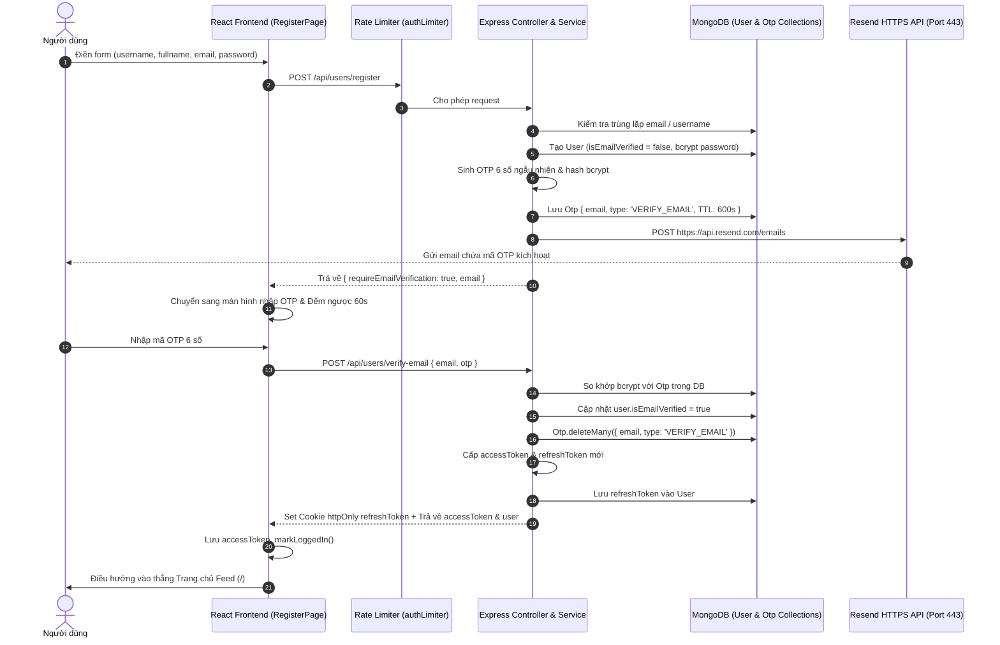
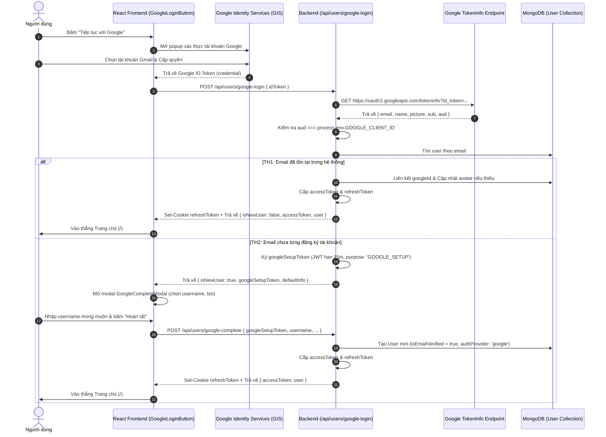

# Document Chức Năng 01: Auth & User Management (Xác Thực & Quản Lý Người Dùng)

> **Tác giả**: Senior Fullstack Developer / Solutions Architect  
> **Dự án**: E-Community (BChat) - Mạng Xã Hội & Trò Chuyện Trực Tuyến  
> **Cập nhật gần nhất**: 2026-11-16  
> **Trạng thái**: 🟢 **Hoàn thiện 100% (Hoàn thành trọn vẹn toàn bộ Nhóm 1: Tasks 1.1 đến 1.4)**  
> **Môi trường hoạt động**: Localhost, Vercel Production, Render Cloud Production  

---

## 1. Tổng Quan Kiến Trúc Phân Hệ Auth (System Architecture Overview)

Phân hệ **Auth & User Management** là xương sống bảo mật của toàn bộ nền tảng BChat. Hệ thống được thiết kế theo các tiêu chuẩn kỹ thuật an ninh hiện đại nhất dành cho Single-Page Application (SPA) đa miền (Cross-Origin giữa Frontend Vercel và Backend Render):

1. **Dual JWT Token với httpOnly Cookie**:
   - `accessToken` (ngắn hạn - 15 phút) lưu tại bộ nhớ Frontend (Memory State).
   - `refreshToken` (dài hạn - 7 ngày) lưu an toàn tuyệt đối trong `httpOnly, Secure, SameSite=None` Cookie, triệt tiêu 100% nguy cơ tấn công đánh cắp phiên qua mã độc XSS.
2. **Refresh Token Rotation & Token Reuse Detection**:
   - Mỗi lần gia hạn phiên đều thu hồi token cũ và sinh token mới.
   - Nếu phát hiện token cũ bị kẻ gian dùng lại, hệ thống lập tức thu hồi toàn bộ phiên đăng nhập của người dùng.
3. **Đăng nhập Google OAuth 2.0 (Google Identity Services)**:
   - Đã xuất bản chính thức **In Production** trên Google Cloud Platform.
   - Phân luồng thông minh: **TH1** (Tài khoản đã có $\rightarrow$ Đăng nhập ngay) và **TH2** (Người dùng mới $\rightarrow$ Form chọn Username độc nhất và Bio $\rightarrow$ Tạo tài khoản).
4. **Xác thực Email OTP Kích Hoạt Tài Khoản (Task 1.4)**:
   - Gửi mã OTP 6 số qua **Resend HTTPS API (Port 443)** siêu tốc, không bị chặn bởi tường lửa đám mây.
   - Băm mã OTP bằng `bcryptjs` (salt 10), tự hủy sau 10 phút qua **MongoDB TTL Index**.
   - Tự động đăng nhập vào thẳng Feed ngay khi kích hoạt thành công.
5. **Thao tác Follow/Unfollow Nguyên Tử (Atomic Operations)**:
   - Sử dụng `$addToSet` và `$pull` triệt tiêu lỗi Race Condition khi người dùng bấm đúp hoặc mạng lag.
   - Chặn người dùng tự follow chính mình ngay tại tầng nghiệp vụ.
6. **Bảo vệ Hệ Thống với Rate Limiting & Trust Proxy**:
   - `authLimiter`: Chặn brute-force đăng nhập/đăng ký (10 req / 15m).
   - `otpLimiter`: Chặn spam gửi mã email (5 req / 15m).
   - Cấu hình `app.set('trust proxy', 1)` tương thích chuẩn xác với Reverse Proxy trên Render Cloud.

---

## 2. Sơ Đồ Trình Tự Các Luồng Xác Thực (Sequence Diagrams)

### 2.1 Luồng Đăng Ký Tài Khoản & Kích Hoạt Email OTP (Task 1.4)



---

### 2.2 Luồng Đăng Nhập Google OAuth 2.0 (TH1 & TH2) (Task 1.3)



---

### 2.3 Luồng Refresh Token Rotation & Chống Tấn Công Phát Lại (Task 1.1)

```mermaid
sequenceDiagram
    autonumber
    participant FE as Axios Interceptor (Trình duyệt)
    participant AuthAPI as Backend (/api/users/refresh-token)
    participant DB as MongoDB (User Collection)

    Note over FE,AuthAPI: Khi accessToken hết hạn (lỗi 401 trên API được bảo vệ)
    FE->>AuthAPI: POST /api/users/refresh-token (Tự đính kèm Cookie refreshToken)
    AuthAPI->>AuthAPI: jwt.verify(refreshToken, REFRESH_TOKEN_SECRET)
    AuthAPI->>DB: Tìm user theo payload.userId

    alt Token hợp lệ và trùng khớp user.refreshToken
        AuthAPI->>AuthAPI: Sinh accessToken mới & newRefreshToken mới (Rotation)
        AuthAPI->>DB: user.refreshToken = newRefreshToken; await user.save()
        AuthAPI-->>FE: res.cookie('refreshToken', newRefreshToken) + { accessToken }
        FE->>FE: Cập nhật accessToken trong bộ nhớ & Retry request ban đầu
    else Token cũ bị dùng lại (Token Reuse / Stolen Token)
        AuthAPI->>DB: user.refreshToken = null (Thu hồi toàn bộ phiên)
        AuthAPI-->>FE: Xóa cookie refreshToken + Lỗi 403 Forbidden
        FE->>FE: Bắn sự kiện auth:logout, xóa state, chuyển hướng về /login
    end
```

---

## 3. Danh Mục Chi Tiết Toàn Bộ API Endpoints (Phân Hệ Auth & User)

| STT | Phương thức | Đường dẫn API | Middleware Kiểm Soát | Payload Đầu Vào | Dữ Liệu Trả Về |
| :---: | :---: | :--- | :---: | :--- | :--- |
| 1 | `POST` | `/api/users/register` | `authLimiter`, `validateRegisterBody` | `{ username, fullname, email, password, confirmPassword }` | `{ message, requireEmailVerification: true, email }` |
| 2 | `POST` | `/api/users/verify-email` | `otpLimiter` | `{ email, otp }` | `{ message, accessToken, user }` + Set-Cookie `refreshToken` |
| 3 | `POST` | `/api/users/resend-verification-otp` | `otpLimiter` | `{ email }` | `{ message, email }` |
| 4 | `POST` | `/api/users/login` | `authLimiter`, `validateLoginBody` | `{ username, password }` | `{ accessToken, user }` + Set-Cookie `refreshToken` |
| 5 | `POST` | `/api/users/google-login` | `authLimiter` | `{ idToken }` | TH1: `{ isNewUser: false, accessToken, user }`<br>TH2: `{ isNewUser: true, googleSetupToken, defaultInfo }` |
| 6 | `POST` | `/api/users/google-complete` | `authLimiter` | `{ googleSetupToken, username, fullname, bio }` | `{ message, accessToken, user }` + Set-Cookie `refreshToken` |
| 7 | `POST` | `/api/users/refresh-token` | `validateRefreshTokenBody` | Tự động đọc từ `req.cookies.refreshToken` | `{ accessToken }` + Set-Cookie `newRefreshToken` |
| 8 | `POST` | `/api/users/logout` | Không | Không | Xóa cookie `refreshToken`, set `user.refreshToken = null` |
| 9 | `POST` | `/api/users/forgot-password` | `otpLimiter`, `validateForgotPasswordBody` | `{ identifier }` (email hoặc username) | `{ message, email, maskedEmail }` |
| 10 | `POST` | `/api/users/verify-otp` | `validateVerifyOtpBody` | `{ email, otp }` | `{ message, resetToken }` (JWT hạn 10m) |
| 11 | `POST` | `/api/users/reset-password` | `validateResetPasswordBody` | `{ email, resetToken, newPassword, confirmPassword }` | `{ message }` (Đổi mật khẩu & thu hồi mọi session cũ) |
| 12 | `GET` | `/api/users/me` | `authMiddleware` | Bearer Token qua Header Authorization | Thông tin chi tiết user đang đăng nhập |
| 13 | `PATCH` / `PUT` | `/api/users/me` | `authMiddleware`, `validateUpdateUserBody` | `{ fullname, bio, avatar, coverImage, socialLinks }` | User sau khi cập nhật |
| 14 | `POST` | `/api/users/follow/:id` | `authMiddleware`, `validateUserIdParam` | `:id` của người cần follow | Cập nhật nguyên tử `$addToSet` (Không trùng lặp ID) |
| 15 | `POST` | `/api/users/unfollow/:id` | `authMiddleware`, `validateUserIdParam` | `:id` của người cần bỏ follow | Cập nhật nguyên tử `$pull` |
| 16 | `GET` | `/api/users/followers/:id` | `validateUserIdParam` | `:id` | Danh sách người theo dõi |
| 17 | `GET` | `/api/users/following/:id` | `validateUserIdParam` | `:id` | Danh sách đang theo dõi |
| 18 | `GET` | `/api/users/:username` | `validateUsernameParam` | `:username` | Thông tin trang cá nhân công khai |

---

## 4. Mô Hình Dữ Liệu Chi Tiết (Data Models)

### 4.1 Schema Người Dùng (`User.js`)
```javascript
const userSchema = new mongoose.Schema({
  username: { type: String, required: true, unique: true, index: true },
  fullname: { type: String, required: true },
  email: { type: String, required: true, unique: true, index: true, lowercase: true, trim: true },
  password: { type: String, required: true },
  googleId: { type: String, sparse: true, unique: true },
  authProvider: { type: String, enum: ['local', 'google'], default: 'local' },
  isEmailVerified: { type: Boolean, default: false },
  refreshToken: { type: String },
  avatar: { type: String, default: "https://cdn-icons-png.flaticon.com/512/149/149071.png" },
  coverImage: { type: String, default: "https://cdn-icons-png.flaticon.com/512/149/149071.png" },
  bio: { type: String, default: "" },
  socialLinks: { type: Array, default: [] },
  followers: [{ type: mongoose.Schema.Types.ObjectId, ref: 'User' }],
  following: [{ type: mongoose.Schema.Types.ObjectId, ref: 'User' }],
  createdAt: { type: Date, default: Date.now },
});
```

### 4.2 Schema Mã Xác Thực OTP (`Otp.js`)
```javascript
const otpSchema = new mongoose.Schema({
  email: { type: String, required: true, lowercase: true, trim: true, index: true },
  otp: { type: String, required: true }, // Luôn được băm bằng bcrypt, không bao giờ lưu plain text
  type: { type: String, enum: ['FORGOT_PASSWORD', 'VERIFY_EMAIL'], default: 'FORGOT_PASSWORD' },
  createdAt: { type: Date, default: Date.now, expires: 600 }, // MongoDB TTL Index: tự hủy sau 10 phút
});
```

---

## 5. Cấu Hình Triển Khai Thực Tế (Cloud Production Configurations)

### 5.1 Cấu hình Backend trên Render
* **Biến môi trường (`Environment Variables`):**
  * `MONGO_URI`: Kết nối cụm MongoDB Atlas Replica Set.
  * `PORT`: Cổng dịch vụ (Render mặc định cấp phát động).
  * `ACCESS_TOKEN_SECRET` / `REFRESH_TOKEN_SECRET`: Khóa bí mật JWT 256-bit.
  * `RESEND_API_KEY`: API Key gửi mail port 443 HTTPS.
  * `GOOGLE_CLIENT_ID`: `877869706102-thcbfu55l384jmpb2tc75abc73mn0vuj.apps.googleusercontent.com`
  * `FE_URL`: `https://ecommunity-frontend.vercel.app`
* **Cấu hình Reverse Proxy & Cookie:**
  * `app.set('trust proxy', 1)`: Bắt buộc để Rate Limiter nhận diện IP người dùng qua header `X-Forwarded-For`.
  * Cookie Options: `httpOnly: true`, `secure: true`, `sameSite: 'none'` (hỗ trợ lưu cookie xuyên domain giữa Vercel và Render).

### 5.2 Cấu hình Frontend trên Vercel
* **Biến môi trường (`Environment Variables`):**
  * `REACT_APP_API_URL`: `https://ecommunity-backend.onrender.com`
  * `REACT_APP_REALTIME_URL`: `https://ecommunity-backend.onrender.com`
  * `REACT_APP_GOOGLE_CLIENT_ID`: Đặt ở dạng **`Type: Config`** (theo đúng quy chuẩn bảo mật mới nhất của Vercel đối với tiền tố `REACT_APP_`).
* **Google Identity Services (GIS):**
  * Script nhúng tại `frontend/index.html`:
    `<script src="https://accounts.google.com/gsi/client" async defer></script>`
  * Nguồn gốc JavaScript được ủy quyền (Authorized Origins) trên Google Cloud:
    - `http://localhost:3000`
    - `http://localhost:5173`
    - `https://ecommunity-frontend.vercel.app`
  * Trạng thái xuất bản (Publishing Status): **`In production`** (mở cửa cho mọi tài khoản Google).

---

## 6. Tổng Kết Tiến Độ Thực Hiện Nhóm 1

- [x] **Task 1.1:** Refresh Token Rotation & httpOnly Cookie & Token Reuse Detection ✅
- [x] **Task 1.2:** Tối ưu Follow/Unfollow Atomic & Anti-Race Condition bằng `$addToSet` ✅
- [x] **Task 1.3:** Tích hợp Đăng nhập Google OAuth 2.0 (Xử lý TH1 vào thẳng & TH2 chọn Username) ✅
- [x] **Task 1.4:** Xác thực Email OTP khi đăng ký mới & Tự động kích hoạt đăng nhập ✅

> 🏆 **Phân hệ 01: Auth & User Management đã hoàn thiện 100% chuẩn Production! Sẵn sàng chuyển tiếp sang Nhóm 2 (Bài viết & Bình luận).**
