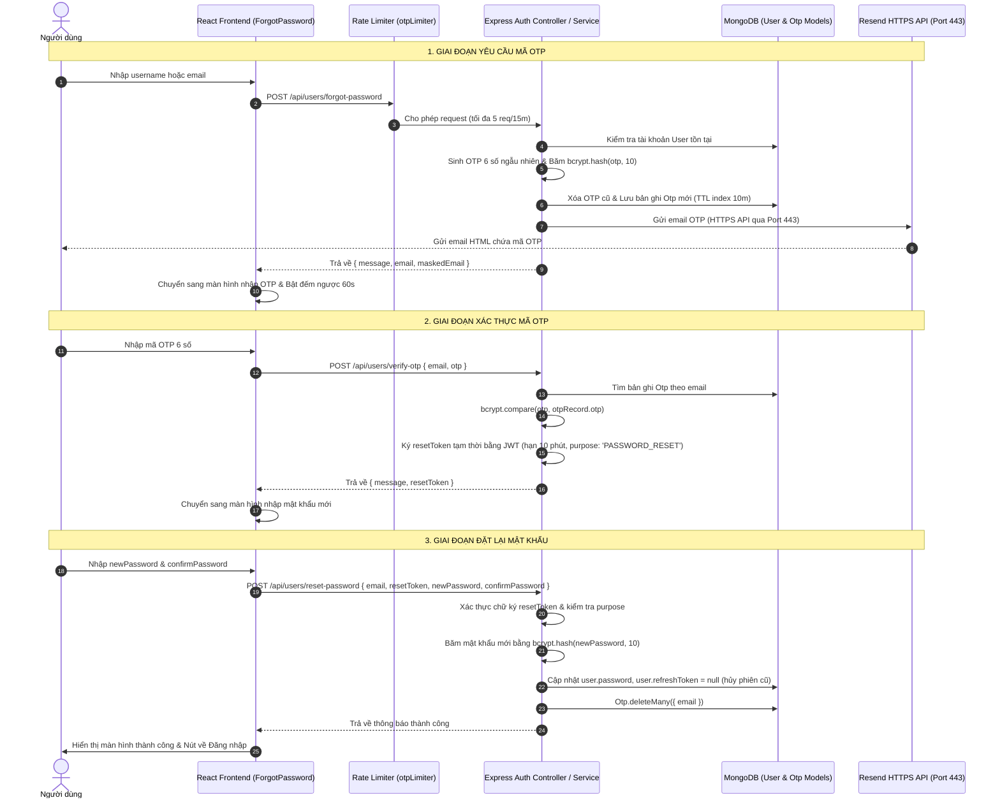

# Document Chức Năng 01: Auth & User Management (Xác Thực & Quản Lý Người Dùng)

> **Tác giả**: Senior Fullstack Developer / Solutions Architect  
> **Dự án**: E-Community (BChat)  
> **Cập nhật gần nhất**: 2026-11-04  
> **Trạng thái**: 🟢 Hoàn thiện 95% (Đã hoàn thành toàn bộ luồng Quên mật khẩu qua OTP Email & Rate Limiting)

---

## 1. Tổng Quan Chức Năng & Kiến Trúc (Overview & Architecture)

Hệ thống Xác thực (Authentication) và Quản lý Người dùng (User Management) đóng vai trò làm nền tảng cho toàn bộ ứng dụng BChat. Cung cấp cơ chế định danh người dùng qua JWT (JSON Web Token) với chiến lược Dual Token (Access Token ngắn hạn + Refresh Token dài hạn), quản lý hồ sơ cá nhân, đổi ảnh đại diện (avatar), tính năng theo dõi/bỏ theo dõi (Follow / Unfollow), và luồng Khôi phục mật khẩu bảo mật qua mã OTP Email thời gian thực.

---

## 2. Chi Tiết Kỹ Thuật Đã Triển Khai (Implemented Features & Tech Specs)

### 2.1 Backend Services & Data Models

* **Model User (`backend/models/User.js`)**:
  * `username` (String, Unique, Required, Index): Tên định danh người dùng.
  * `fullname` (String, Required): Họ tên hiển thị.
  * `email` (String, Unique, Required, Index): Email người dùng.
  * `password` (String, Required, Hashed by `bcryptjs` với salt round = 10).
  * `avatar` (String): URL ảnh đại diện.
  * `cover` (String): URL ảnh bìa cá nhân.
  * `bio` (String): Tiểu sử cá nhân.
  * `followers` (Array of ObjectId `User`): Danh sách người theo dõi.
  * `following` (Array of ObjectId `User`): Danh sách người đang theo dõi.
  * `refreshToken` (String): Lưu Refresh Token hiện tại để revoke / rotation.

* **Model OTP (`backend/models/Otp.js`)**:
  * `email` (String, Required, Index): Email nhận OTP.
  * `otp` (String, Required): Mã OTP đã được băm bằng bcrypt (không lưu plain text).
  * `type` (String, Enum: `['FORGOT_PASSWORD', 'VERIFY_EMAIL']`, Default: `'FORGOT_PASSWORD'`).
  * `createdAt` (Date, Default: `Date.now`, `expires: 600`): **MongoDB TTL Index** tự động xóa vĩnh viễn bản ghi sau 600 giây (10 phút).

* **Email Service Đa Nền Tảng (`backend/services/emailService.js`)**:
  * **Resend HTTP API (Port 443 HTTPS)**: Giải pháp chính cho môi trường Cloud / Render. Gửi trực tiếp qua REST API bằng native `fetch`, hoàn toàn không bị ảnh hưởng bởi chính sách chặn cổng SMTP của Render Free Tier. Tốc độ gửi cực nhanh (< 1 giây).
  * **Brevo HTTP API (Port 443 HTTPS)**: Phương án dự phòng với hạn mức 300 email/ngày tới mọi địa chỉ nhận.
  * **Gmail SMTP (Nodemailer)**: Fallback cho localhost với bộ đếm `connectionTimeout: 8000ms` chống hiện tượng treo vô tận (Anti-Hang).
  * **Mẫu Email HTML chuẩn nhận diện thương hiệu BChat**: Giao diện Dark Theme cao cấp, viền vàng `#eab308`, hiển thị rõ mã OTP 6 số, thông tin bảo mật và thời hạn sử dụng.

* **Rate Limiting & Security Middleware (`backend/middleware/rateLimiter.js`)**:
  * `authLimiter`: Giới hạn tối đa 10 lần thử đăng nhập/đăng ký trong 15 phút cho mỗi IP để chống Brute-force mật khẩu.
  * `otpLimiter`: Giới hạn tối đa 5 lần yêu cầu OTP trong 15 phút cho mỗi IP để chống spam email.

* **API Endpoints (`backend/routes/userRoutes.js`)**:
  | Method | Endpoint | Middleware / Rate Limit | Mô Tả |
  | :--- | :--- | :---: | :--- |
  | `POST` | `/api/users/register` | `authLimiter`, `validateRegisterBody` | Đăng ký tài khoản mới với username, email, fullname, password. |
  | `POST` | `/api/users/login` | `authLimiter`, `validateLoginBody` | Đăng nhập bằng username/email + password, nhận Access Token & Refresh Token. |
  | `POST` | `/api/users/refresh-token` | `validateRefreshTokenBody` | Cấp lại Access Token mới khi Access Token cũ hết hạn. |
  | `POST` | `/api/users/logout` | None | Hủy phiên đăng nhập, thu hồi refresh token của người dùng. |
  | `POST` | `/api/users/forgot-password` | `otpLimiter`, `validateForgotPasswordBody` | Gửi mã OTP 6 số qua email xác thực khôi phục mật khẩu. |
  | `POST` | `/api/users/verify-otp` | `validateVerifyOtpBody` | Xác thực mã OTP 6 số và cấp `resetToken` hạn 10 phút. |
  | `POST` | `/api/users/reset-password` | `validateResetPasswordBody` | Đặt lại mật khẩu mới thông qua `resetToken`. Hủy mọi phiên cũ. |
  | `GET` | `/api/users/me` | `authMiddleware` | Lấy thông tin user đăng nhập hiện tại từ JWT payload. |
  | `GET` | `/api/users/profile/:username` | Optional Auth | Xem trang cá nhân người dùng theo username (kèm số lượng follow). |
  | `PATCH` / `PUT` | `/api/users/me` | `authMiddleware`, `validateUpdateUserBody` | Cập nhật thông tin cá nhân (fullname, bio, avatar, cover). |
  | `POST` | `/api/users/follow/:id` | `authMiddleware`, `validateUserIdParam` | Follow một người dùng. |
  | `POST` | `/api/users/unfollow/:id` | `authMiddleware`, `validateUserIdParam` | Unfollow một người dùng. |

### 2.2 Frontend Integration

* **Trang Quên mật khẩu (`frontend/src/pages/ForgotPasswordPage/ForgotPassword.tsx`)**:
  * Thiết kế UI/UX Pro Max chia đôi màn hình (Split-Screen Hero Layout) chuẩn nhận diện BChat.
  * Quản lý State phân tầng 4 bước (`REQUEST_OTP` $\rightarrow$ `VERIFY_OTP` $\rightarrow$ `RESET_PASSWORD` $\rightarrow$ `COMPLETED`).
  * Có bộ đếm ngược 60s (`countdown`) trước khi cho phép bấm nút "Gửi lại mã" (Resend OTP).
  * Hiển thị email đã che bảo mật (`maskedEmail` dạng `b***@gmail.com`).
  * Nút toggle con mắt hiển thị/ẩn mật khẩu ở cả 2 ô mật khẩu mới và xác nhận mật khẩu.

* **Axios Interceptor (`frontend/src/api/axios.ts`) & Auth Context**:
  * Tự động bắt lỗi HTTP 401 để tự làm mới token qua `/refresh-token` mà không làm gián đoạn trải nghiệm người dùng.

---

## 3. Danh Mục Các Công Việc Đã Hoàn Thành (Completed Tasks)

- [x] **Xây dựng luồng Quên mật khẩu & Gửi mã OTP Email thực tế**: Đã tích hợp hoàn chỉnh từ Frontend đến Backend.
- [x] **Giải quyết triệt để rào cản mạng trên Render Cloud**: Chuyển từ SMTP truyền thống sang **Resend HTTPS API (Port 443)**, không bị firewall Render chặn cổng 465/587.
- [x] **Bảo mật mã OTP chuẩn Production**:
  - Không lưu mã OTP thô (được hash bằng bcrypt).
  - Tự hủy sau 10 phút qua MongoDB TTL Index.
  - Cấp token trung gian `resetToken` (JWT) chống bypass bước OTP.
  - Hủy toàn bộ `refreshToken` cũ khi đổi mật khẩu thành công.
- [x] **Bảo vệ chống Brute-force & Spam**: Cấu hình `authLimiter` và `otpLimiter` qua `express-rate-limit`.
- [x] **Kiểm toán kiến trúc mã nguồn toàn vẹn qua Graphify**: Xây dựng Knowledge Graph hoàn chỉnh (686 nodes, 1,260 edges, 59 communities) và xuất báo cáo `GRAPH_REPORT.md` + bản đồ tương tác `graph.html`.

---

## 4. Các Công Việc Tiếp Theo Cần Triển Khai (Upcoming Tasks & Roadmap)

> [!IMPORTANT]
> Dưới đây là danh sách các task còn lại của phân hệ Auth & User Management được xếp theo độ ưu tiên:

### 🎯 Ưu tiên 1 (High Priority - An Ninh & Tiện Ích Đăng Nhập):
- [x] **Task 1.1: Chuyển Refresh Token sang `httpOnly Cookie` & Refresh Token Rotation**:
   - Lưu trữ Refresh Token hoàn toàn trong `httpOnly, secure, sameSite=none` Cookie (hỗ trợ chéo domain Vercel & Render).
   - Cơ chế Refresh Token Rotation: mỗi lần gia hạn phiên đều sinh cặp `accessToken` và `newRefreshToken` mới, cập nhật vào Cookie và MongoDB.
   - Cơ chế Token Reuse Detection: tự động phát hiện và thu hồi toàn bộ phiên nếu phát hiện refresh token cũ bị sử dụng lại (chống Token Replay Attack).
- [x] **Task 1.2: Chống Race Condition trong thao tác Follow/Unfollow & Chặn Tự Follow**:
   - Chặn người dùng tự theo dõi chính mình (`currentUserId === targetUserId`) ở tầng service.
   - Chuyển toàn bộ thao tác sang toán tử nguyên tử MongoDB: `$addToSet` (thay thế `$push`) và `$pull` để chống trùng lặp ID khi nhận request song song (Double-click / Network lag).
   - Kiểm tra điều kiện atomic `{ _id: targetUserId, followers: { $ne: currentUserId } }` loại bỏ 4 query tuần tự thừa, tăng tốc độ phản hồi.
- [x] **Task 1.3: Tích hợp Google OAuth 2.0 (Đăng nhập nhanh với Google)**:
   - Xử lý phân nhánh 2 trường hợp:
     - **TH1 (Tài khoản đã tồn tại):** Đăng nhập vào thẳng trong 0.5s, cấp `accessToken` và cập nhật `refreshToken` vào `httpOnly Cookie`.
     - **TH2 (Tài khoản mới toanh):** Cấp `googleSetupToken` tạm thời (15m) $\rightarrow$ Frontend bật modal **Hoàn tất hồ sơ** để người dùng chọn `username` độc nhất, chỉnh họ tên và viết tiểu sử ngắn $\rightarrow$ Gọi `/google-complete` tạo tài khoản chính thức.
   - Xác thực an toàn qua Google OAuth2 tokeninfo endpoint, không phụ thuộc thư viện ngoài, hoạt động mượt mà với React 19 và Google Identity Services (GIS).
4. **Task 1.4: Xác thực Email khi đăng ký tài khoản mới (Verify Email)**:
   - Tái sử dụng `emailService` và model `Otp` với `type: 'VERIFY_EMAIL'` để kích hoạt tài khoản sau khi đăng ký, loại bỏ hoàn toàn tài khoản ảo (bot accounts).
5. **Đổi mật khẩu từ trang Cài đặt (Change Password in Profile Setting)**:
   - Cho phép người dùng đang đăng nhập đổi mật khẩu bằng cách nhập: Mật khẩu hiện tại $\rightarrow$ Mật khẩu mới.
