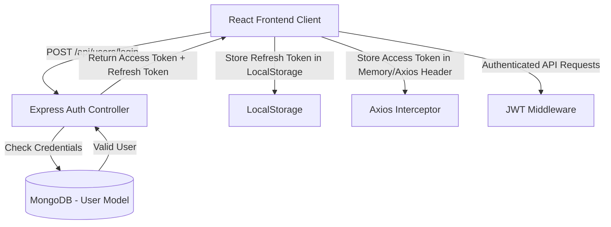

# Document Chức Năng 01: Auth & User Management (Xác Thực & Quản Lý Nguồn Dùng)

> **Tác giả**: Senior Fullstack Developer / Solutions Architect  
> **Dự án**: E-Community (BChat)  
> **Cập nhật gần nhất**: 2026-10-08  

---

## 1. Tổng Quan Chức Năng & Kiến Trúc (Overview & Architecture)

Hệ thống Xác thực (Authentication) và Quản lý Người dùng (User Management) đóng vai trò làm nền tảng cho toàn bộ ứng dụng BChat. Cung cấp cơ chế định danh người dùng qua JWT (JSON Web Token) với chiến lược Dual Token (Access Token ngắn hạn + Refresh Token dài hạn), quản lý hồ sơ cá nhân, đổi ảnh đại diện (avatar), và tính năng theo dõi/bỏ theo dõi (Follow / Unfollow).

---

## 2. Chi Tiết Kỹ Thuật Đã Triển Khai (Implemented Features & Tech Specs)

### 2.1 Backend Services & API Endpoints

* **Model Schema (`backend/models/User.js`)**:
  * `username` (String, Unique, Required, Index): Tên định danh người dùng.
  * `fullname` (String, Required): Họ tên hiển thị.
  * `password` (String, Required, Hashed by `bcryptjs` với salt round = 10).
  * `avatar` (String): URL ảnh đại diện.
  * `cover` (String): URL ảnh bìa cá nhân.
  * `bio` (String): Tiểu sử cá nhân.
  * `followers` (Array of ObjectId `User`): Danh sách người theo dõi.
  * `following` (Array of ObjectId `User`): Danh sách người đang theo dõi.
  * `refreshToken` (String): Lưu Refresh Token hiện tại để revoke / rotation.

* **API Endpoints (`backend/routes/userRoutes.js`)**:
  | Method | Endpoint | Auth Required | Mô Tả |
  | :--- | :--- | :---: | :--- |
  | `POST` | `/api/users/register` | No | Đăng ký tài khoản mới với username, fullname, password, confirmPassword. |
  | `POST` | `/api/users/login` | No | Đăng nhập, nhận Access Token (15m/1h) & Refresh Token (7d). |
  | `POST` | `/api/users/refresh-token` | No | Cấp lại Access Token mới khi Access Token cũ hết hạn. |
  | `GET` | `/api/users/me` | Yes | Lấy thông tin user đăng nhập hiện tại từ JWT payload. |
  | `GET` | `/api/users/profile/:username` | Yes/No | Xem trang cá nhân người dùng theo username (kèm số lượng follow). |
  | `PUT` | `/api/users/profile` | Yes | Cập nhật thông tin cá nhân (fullname, bio, avatar, cover). |
  | `POST` | `/api/users/follow/:id` | Yes | Follow hoặc Unfollow một user (Toggle mechanism). |

### 2.2 Frontend Integration

* **Auth Context & Store (`frontend/src/contexts/AuthContext.tsx`, `authStore.ts`)**:
  * Tự động kiểm tra token khởi chạy app.
  * Axios Interceptors (`frontend/src/api/axios.ts`): Tự động bắt lỗi HTTP 401/403 để gọi refresh token hoặc logout nếu refresh token không còn hợp lệ.
* **Giao diện Auth Page**:
  * Đã nâng cấp Split-Screen Hero Layout chuẩn UI/UX Pro Max (`LoginPage`, `RegisterPage`, `ForgotPasswordPage`).
  * Có nút ẩn/hiện mật khẩu (eye toggle) và icon minh họa từng ô input.

---

## 3. Hạn Chế, Lỗ Hổng & Thiếu Sót Hiện Tại (Limitations, Security & Tech Debt)

> [!WARNING]
> Các lỗ hổng và thiếu sót dưới đây cần được ưu tiên khắc phục trước khi release Production.

1. **Lưu trữ Refresh Token chưa thực sự an toàn (Security Vulnerability)**:
   * **Hiện trạng**: Refresh Token đang được lưu ở `localStorage` trên trình duyệt Client.
   * **Rủi ro**: Dễ bị tấn công **XSS (Cross-Site Scripting)** đánh cắp token nếu có thư viện thứ ba bị dính mã độc.
   * **Giải pháp chuẩn Senior**: Nên chuyển Refresh Token sang **`httpOnly`, `secure`, `sameSite=strict` Cookie**.

2. **Chưa có OAuth2 / Social Login**:
   * Chưa hỗ trợ Đăng nhập bằng Google, Facebook, Apple.
   * Người dùng bắt buộc phải đăng ký tài khoản mật khẩu thủ công.

3. **Chưa có Xác thực Email / OTP (Account Verification & Password Reset)**:
   * **Quên mật khẩu**: Hiện tại API quên mật khẩu ở `ForgotPassword.tsx` mới chỉ là mock response / placeholder, chưa gửi email reset link thực sự qua Nodemailer / SendGrid / AWS SES.
   * **Chưa verify email**: Đăng ký không cần xác thực email, dẫn đến nguy cơ spam tài khoản rác (bot accounts).

4. **Rate Limiting & Brute-force Protection**:
   * Chưa áp dụng `express-rate-limit` cho route `/api/users/login` và `/api/users/register`.
   * Hacker có thể dùng script Brute-force mật khẩu hoặc spam đăng ký làm treo server và cạn kiệt MongoDB connection pool.

5. **Hiệu năng Query Follow/Unfollow & Race Condition**:
   * Logic Follow đang sử dụng `User.findById` rồi push/pull phần tử array. Nếu 2 request follow đồng thời gửi lên có thể bị **Race Condition** ghi đè mảng.
   * Nên dùng `$addToSet` và `$pull` trực tiếp trong `User.findByIdAndUpdate` ở MongoDB.

---

## 4. Kế Hoạch Cải Tiến & Roadmap (Senior Dev Recommendations)

- [ ] **Task 1**: Chuyển Refresh Token sang `httpOnly Cookie` và triển khai Refresh Token Rotation (hủy Refresh Token cũ khi dùng token đó cấp Access Token mới).
- [ ] **Task 2**: Cấu hình `express-rate-limit` (tối đa 5 lần thử login sai / phút cho mỗi IP).
- [ ] **Task 3**: Tích hợp Nodemailer + Redis để làm luồng gửi mã OTP khôi phục mật khẩu thực sự.
- [ ] **Task 4**: Tích hợp Google OAuth 2.0 (`passport-google-oauth20` hoặc Google One Tap UI).
- [ ] **Task 5**: Chuyển câu lệnh Follow sang atomic update `$addToSet` / `$pull` để chống Race Condition.
