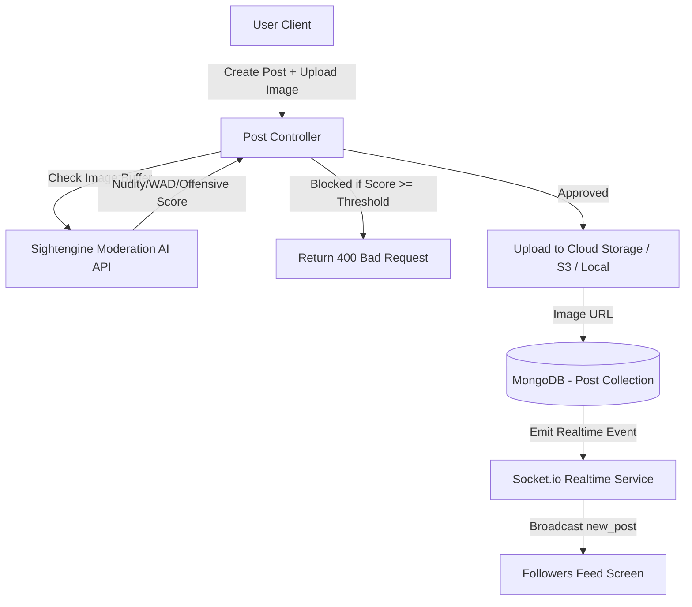

# Document Chức Năng 02: Post & Feed System (Bài Viết, Bảng Tin & Kiểm Duyệt AI)

> **Tác giả**: Senior Fullstack Developer / Solutions Architect  
> **Dự án**: E-Community (BChat)  
> **Cập nhật gần nhất**: 2026-10-08  

---

## 1. Tổng Quan Chức Năng & Kiến Trúc (Overview & Architecture)

Hệ thống Bài viết (Post System) là trái tim của mạng xã hội E-Community, cho phép người dùng đăng tải nội dung văn bản, hình ảnh, tương tác thả tim (Like/Unlike), xem chi tiết bài viết và duyệt bảng tin (Feed). Điểm đặc biệt của hệ thống là có tích hợp dịch vụ **AI Content Moderation (Sightengine API)** tự động kiểm duyệt hình ảnh tải lên để chặn ảnh nhạy cảm / bạo lực / khiêu dâm trước khi lưu vào DB.

---

## 2. Chi Tiết Kỹ Thuật Đã Triển Khai (Implemented Features & Tech Specs)

### 2.1 Backend Services & Data Schema

* **Model Schema (`backend/models/Post.js`)**:
  * `author` (ObjectId `User`, Required, Index): Người tạo bài viết.
  * `content` (String, Required): Nội dung văn bản bài viết.
  * `image` (String): URL hình ảnh đính kèm bài viết.
  * `likes` (Array of ObjectId `User`): Danh sách người dùng đã thả tim bài viết.
  * `comments` (Array of ObjectId `Comment`): Danh sách bình luận liên quan.
  * `createdAt`, `updatedAt` (Timestamps).

* **AI Content Moderation Service (`backend/services/contentModerationService.js`)**:
  * Kiểm duyệt ảnh tự động qua Sightengine API.
  * Tính toán chỉ số rủi ro: `nudity`, `wad` (weapon, alcohol, drugs), `offensive`.
  * Đặt ngưỡng chặn linh hoạt qua biến môi trường `SIGHTENGINE_BLOCK_THRESHOLD` (Default = `0.3`).

* **API Endpoints (`backend/routes/postRoutes.js`)**:
  | Method | Endpoint | Auth Required | Mô Tả |
  | :--- | :--- | :---: | :--- |
  | `GET` | `/api/posts` | Yes | Lấy danh sách bài viết trên Newsfeed (phân trang page/limit). |
  | `POST` | `/api/posts` | Yes | Tạo bài viết mới (hỗ trợ multipart upload ảnh + kiểm duyệt AI). |
  | `GET` | `/api/posts/:id` | Yes | Lấy chi tiết 1 bài viết kèm danh sách comment & author. |
  | `PUT` | `/api/posts/:id` | Yes | Chỉnh sửa bài viết (chỉ tác giả có quyền). |
  | `DELETE` | `/api/posts/:id` | Yes | Xóa bài viết (chỉ tác giả có quyền). |
  | `POST` | `/api/posts/:id/like` | Yes | Thả tim / Bỏ thả tim bài viết (Toggle Like). |

### 2.2 Frontend Integration

* **Feed Store (`frontend/src/stores/feedStore.ts`)**:
  * Quản lý state danh sách bài viết, phân trang cursor/page.
  * Cập nhật thời gian thực khi có ai thả tim hoặc xóa bài viết.
* **UI Components**:
  * `CreatePostModal`: Modal tạo bài viết mượt mà với xem trước ảnh chọn, báo lỗi ngay lập tức nếu ảnh vi phạm tiêu chuẩn cộng đồng.
  * `Post`: Card bài viết hỗ trợ xem ảnh phóng to, thả tim mượt mà, định dạng thời gian tương đối (`moment` / `date-fns`).

---

## 3. Hạn Chế, Lỗ Hổng & Thiếu Sót Hiện Tại (Limitations & Tech Debt)

> [!WARNING]
> Các vấn đề kiến trúc cần nâng cấp để ứng dụng chịu tải tốt khi lượng bài viết lớn.

1. **Thuật Toán Feed Hiện Tại Còn Đơn Giản (Unoptimized Timeline Feed)**:
   * **Hiện trạng**: API `/api/posts` đang trả về toàn bộ bài viết mới nhất sắp xếp theo `createdAt: -1` mà chưa lọc theo danh sách người dùng được `following`.
   * **Hạn chế**: Khi có hàng ngàn user đăng bài, feed sẽ bị loãng và không cá nhân hóa cho từng user.
   * **Giải pháp Senior**: Cần triển khai Fan-out on Write hoặc Fan-out on Read (dựa trên Redis Timeline Cache) chỉ lấy bài viết từ người mình đã follow + gợi ý bài viết xu hướng.

2. **Chưa Hỗ Trợ Đa Phương Tiện Nâng Cao (Multiple Images & Video)**:
   * Hiện tại mỗi bài viết chỉ hỗ trợ tối đa **1 ảnh duy nhất** (`image: String`).
   * Chưa hỗ trợ đăng nhiều ảnh (Carousel/Grid layout), chưa hỗ trợ video / GIF.

3. **Chưa Có Lọc Văn Bản Rác / Từ Cấm (Text Moderation)**:
   * Dịch vụ Moderation hiện mới chỉ kiểm duyệt hình ảnh qua Sightengine.
   * Văn bản bài viết chưa được kiểm duyệt các từ ngữ tục tĩu, vi phạm pháp luật hoặc spam link độc hại.

4. **Vấn Đề Phân Trang (Offset Pagination Bottleneck)**:
   * Hiện đang dùng `skip((page - 1) * limit).limit(limit)`.
   * Khi số lượng bài viết lên đến hàng triệu bản ghi, lệnh `skip()` trong MongoDB sẽ rất chậm (O(N)).
   * Cần chuyển sang **Cursor-Based Pagination** (`createdAt < lastSeenId`).

---

## 4. Kế Hoạch Cải Tiến & Roadmap (Senior Dev Recommendations)

- [ ] **Task 1**: Chuyển API Feed sang Cursor-Based Pagination dùng `_id` / `createdAt` làm cursor.
- [ ] **Task 2**: Triển khai thuật toán Personal Newsfeed (chỉ hiển thị bài viết của chính mình + những người mình follow).
- [ ] **Task 3**: Mở rộng Post Model hỗ trợ mảng ảnh `images: [String]` và bố cục Grid trên Frontend.
- [ ] **Task 4**: Tích hợp thư viện lọc từ cấm văn bản (Bad-words filter / OpenAI Text Moderation API).
- [ ] **Task 5**: Thêm tính năng Bookmark / Lưu bài viết yêu thích.
