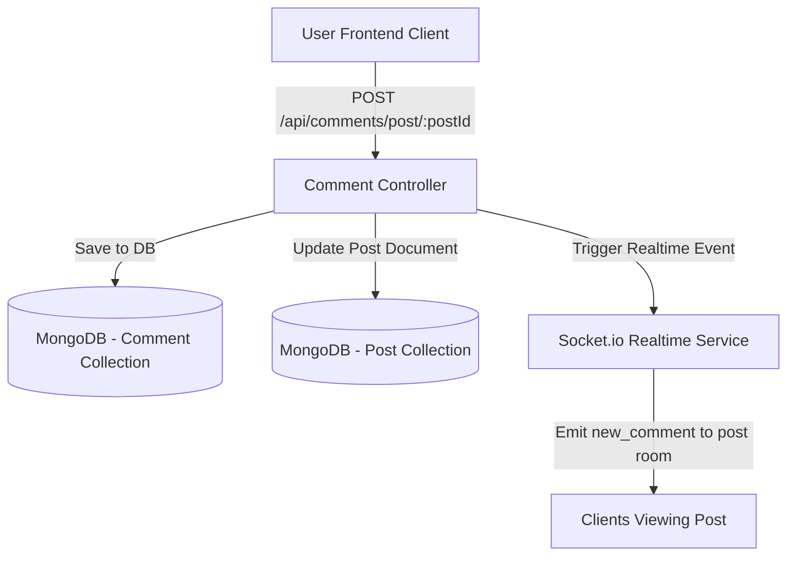

# Document Chức Năng 03: Comment System (Bình Luận & Phản Hồi Bài Viết)

> **Tác giả**: Senior Fullstack Developer / Solutions Architect  
> **Dự án**: E-Community (BChat)  
> **Cập nhật gần nhất**: 2026-10-08  

---

## 1. Tổng Quan Chức Năng & Kiến Trúc (Overview & Architecture)

Hệ thống Bình luận (Comment System) cho phép người dùng thảo luận bên dưới mỗi bài viết, gửi ý kiến cá nhân và tạo sự tương tác hai chiều trong cộng đồng. Tích hợp cập nhật thời gian thực qua WebSocket để mọi người đang xem bài viết đều thấy comment mới xuất hiện ngay lập tức.

---

## 2. Chi Tiết Kỹ Thuật Đã Triển Khai (Implemented Features & Tech Specs)

### 2.1 Backend Services & Data Schema

* **Model Schema (`backend/models/Comment.js`)**:
  * `post` (ObjectId `Post`, Required, Index): Bài viết chứa bình luận.
  * `author` (ObjectId `User`, Required): Người gửi bình luận.
  * `content` (String, Required): Nội dung bình luận.
  * `likes` (Array of ObjectId `User`): Danh sách người thích bình luận này.
  * `createdAt`, `updatedAt` (Timestamps).

* **API Endpoints (`backend/routes/commentRoutes.js`)**:
  | Method | Endpoint | Auth Required | Mô Tả |
  | :--- | :--- | :---: | :--- |
  | `GET` | `/api/comments/post/:postId` | Yes | Lấy danh sách bình luận của một bài viết. |
  | `POST` | `/api/comments/post/:postId` | Yes | Thêm bình luận mới vào bài viết. |
  | `DELETE` | `/api/comments/:id` | Yes | Xóa bình luận (chỉ tác giả comment hoặc tác giả bài viết có quyền xóa). |
  | `POST` | `/api/comments/:id/like` | Yes | Thả tim / Bỏ thả tim bình luận. |

### 2.2 Frontend Integration

* **Post Detail Page & Post Modal**:
  * Cho phép gõ bình luận và gửi bằng phím `Enter`.
  * Hiển thị danh sách bình luận với avatar, họ tên tác giả và thời gian tương đối.
  * Nút xóa comment hiển thị đúng phân quyền.

---

## 3. Hạn Chế, Lỗ Hổng & Thiếu Sót Hiện Tại (Limitations & Tech Debt)

> [!WARNING]
> Những điểm thiếu sót về tính năng và trải nghiệm người dùng trong hệ thống bình luận.

1. **Thiếu Bình Luận Phân Cấp (Nested / Threaded Comments - Reply to Comment)**:
   * **Hiện trạng**: Bình luận hiện tại đang ở cấu trúc 1 cấp phẳng (flat structure).
   * **Hạn chế**: Không thể trả lời trực tiếp (Reply) vào một bình luận của người khác, gây khó khăn cho các cuộc thảo luận dài.
   * **Giải pháp**: Cần bổ sung trường `parentId` (ObjectId `Comment`) trong `Comment` model để hỗ trợ cây bình luận n-cấp.

2. **Chưa Hỗ Trợ Đính Kèm Hình Ảnh / Sticker / Emoji Picker**:
   * Bình luận mới chỉ chấp nhận chuỗi văn bản thuần (plain text).
   * Chưa có bộ chọn Emoji chuẩn (Emoji Picker) hoặc tải ảnh/GIF đính kèm bình luận.

3. **Chưa Có Mention người dùng (@username)**:
   * Khi nhắc đến tên người khác trong bình luận, hệ thống chưa tự động gợi ý danh sách người dùng và chưa gửi thông báo đẩy cho người được mention.

4. **Vấn Đề Phân Trang Bình Luận (Comment Pagination)**:
   * Khi bài viết có hàng ngàn comment, việc query toàn bộ comment một lúc gây nặng dung lượng mạng và làm đơ giao diện.
   * Cần phân trang bình luận (vd: 10 comment / lần bấm "Xem thêm bình luận").

---

## 4. Kế Hoạch Cải Tiến & Roadmap (Senior Dev Recommendations)

- [ ] **Task 1**: Thêm trường `parentId` vào Schema và nâng cấp UI để hỗ trợ luồng Reply Comment (Nested Replies).
- [ ] **Task 2**: Tích hợp Emoji Picker (`emoji-mart` hoặc thư viện tương đương) vào ô nhập comment.
- [ ] **Task 3**: Xây dựng tính năng Mention `@username` tự động gửi Notification đến người được gắn thẻ.
- [ ] **Task 4**: Phân trang danh sách bình luận theo Lazy Loading / Infinite Scroll.
