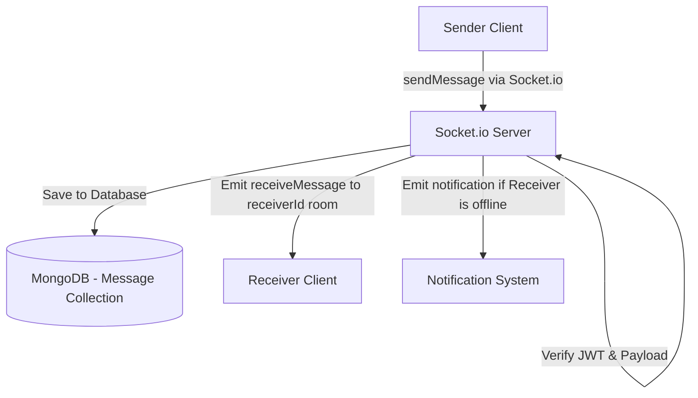

# Document Chức Năng 04: Realtime Messaging & Chat System (Trò Chuyện Thời Gian Thực)

> **Tác giả**: Senior Fullstack Developer / Solutions Architect  
> **Dự án**: E-Community (BChat)  
> **Cập nhật gần nhất**: 2026-10-08  

---

## 1. Tổng Quan Chức Năng & Kiến Trúc (Overview & Architecture)

Hệ thống Trò chuyện Thời gian thực (Realtime Messaging) cho phép người dùng nhắn tin trực tiếp (1-on-1 Chat) hoặc nhắn tin nhóm (Group Chat). Kiến trúc sử dụng **Socket.io** tích hợp middleware xác thực JWT trực tiếp ở bước Socket Handshake, quản lý trạng thái Online/Offline (Presence Tracking) thông qua mảng Socket Room cá nhân (`socket.join(userId)`).

---

## 2. Chi Tiết Kỹ Thuật Đã Triển Khai (Implemented Features & Tech Specs)

### 2.1 Backend Services & Data Schema

* **Model Schema (`backend/models/Message.js`)**:
  * `sender` (ObjectId `User`, Required, Index): Người gửi tin nhắn.
  * `receiver` (ObjectId `User`, Required, Index): Người nhận tin nhắn (nếu chat 1-1).
  * `content` (String, Required): Nội dung tin nhắn.
  * `isRead` (Boolean, Default = false): Trạng thái đã đọc.
  * `createdAt`, `updatedAt` (Timestamps).

* **Socket.io Realtime Service (`backend/services/realtimeService.js`)**:
  * Socket Authentication Middleware: Bắt buộc gửi JWT token trong `handshake.auth.token` hoặc `headers.authorization`.
  * **Presence Tracking (Trạng thái Online/Offline)**:
    * Duy trì `Map<userId, Set<socketId>>` trên memory server.
    * Tự động broadcast sự kiện `user_online` khi người dùng kết nối socket đầu tiên.
    * Tự động broadcast sự kiện `user_offline` khi tất cả các socket tab của người dùng ngắt kết nối.
  * Socket Events:
    * `sendMessage` -> `receiveMessage`
    * `user_online`, `user_offline`, `online_users`

* **API Endpoints (`backend/routes/messageRoutes.js`)**:
  | Method | Endpoint | Auth Required | Mô Tả |
  | :--- | :--- | :---: | :--- |
  | `GET` | `/api/messages/:userId` | Yes | Lấy lịch sử tin nhắn 1-1 với một người dùng cụ thể. |
  | `POST` | `/api/messages` | Yes | Gửi tin nhắn mới qua REST API (dự phòng cho Socket). |
  | `GET` | `/api/messages/conversations` | Yes | Lấy danh sách các cuộc trò chuyện gần nhất. |
  | `PATCH` | `/api/messages/read/:senderId` | Yes | Đánh dấu tất cả tin nhắn từ sender là Đã đọc. |

### 2.2 Frontend Integration

* **Message Store (`frontend/src/stores/messageStore.ts`)**:
  * Quản lý trạng thái danh sách hội thoại, tin nhắn hiện tại và badge tin nhắn chưa đọc.
* **Presence Store (`frontend/src/stores/presenceStore.ts`)**:
  * Lắng nghe `user_online` / `user_offline` để cập nhật chấm xanh (Online dot) trên avatar bạn bè theo thời gian thực.
* **Message Page UI**:
  * Giao diện khung chat hiện đại, hỗ trợ cuộn tự động xuống tin nhắn mới nhất (`scrollIntoView`).

---

## 3. Hạn Chế, Lỗ Hổng & Thiếu Sót Hiện Tại (Limitations & Tech Debt)

> [!WARNING]
> Kiến trúc Socket hiện tại cần xử lý các bài toán Scalability & Security khi mở rộng hệ thống.

1. **Chưa Có Socket Adapter Cho Đa Server (Multi-node Scaling Limit)**:
   * **Hiện trạng**: Presence Tracking (`onlineUsers` Map) và Socket Room đang lưu hoàn toàn trên RAM của **1 Node.js process duy nhất**.
   * **Rủi ro**: Khi triển khai nhiều instance Backend (dùng Load Balancer / Kubernetes), các Socket Client thuộc các server khác nhau sẽ **KHÔNG THỂ** gửi tin nhắn realtime cho nhau.
   * **Giải pháp Senior**: Cần bắt buộc cài đặt **`@socket.io/redis-adapter`** và chuyển Presence State sang **Redis Pub/Sub & Redis Hashes**.

2. **Chưa Hỗ Trợ Đính Kèm File / Ảnh Trong Chat**:
   * Tin nhắn hiện tại chỉ chứa văn bản `content: String`.
   * Chưa hỗ trợ gửi ảnh, file tài liệu (PDF, DOCX), tin nhắn thoại (Voice message).

3. **Chưa Có Typing Indicator (Đang nhập tin nhắn...)**:
   * Thiếu sự kiện `typing` / `stop_typing` để người dùng biết người kia đang gõ phản hồi.

4. **Chưa Có Mã Hóa Đầu Đọc (End-to-End Encryption - E2EE)**:
   * Tin nhắn lưu dạng plain text trong MongoDB. Cần cân nhắc mã hóa dữ liệu nhạy cảm ở mức database.

5. **Trạng Thái Đã Đọc (Read Receipts) Chưa Realtime**:
   * Khi người nhận mở khung chat, người gửi chưa nhận được tín hiệu realtime `message_read` ngay lập tức để chuyển icon 1 tích sang 2 tích xanh.

---

## 4. Kế Hoạch Cải Tiến & Roadmap (Senior Dev Recommendations)

- [ ] **Task 1**: Tích hợp `@socket.io/redis-adapter` và Redis Pub/Sub để hỗ trợ Horizontal Scaling nhiều backend instances.
- [ ] **Task 2**: Bổ sung tính năng đính kèm ảnh & file vào tin nhắn chat.
- [ ] **Task 3**: Thêm Socket Event `typing` và `stop_typing` hiển thị hiệu ứng ba chấm đang gõ.
- [ ] **Task 4**: Thêm sự kiện `message_read` realtime cập nhật dấu tích đã đọc.
- [ ] **Task 5**: Thêm tính năng Thu hồi tin nhắn (Unsend message) và Xóa hội thoại.
