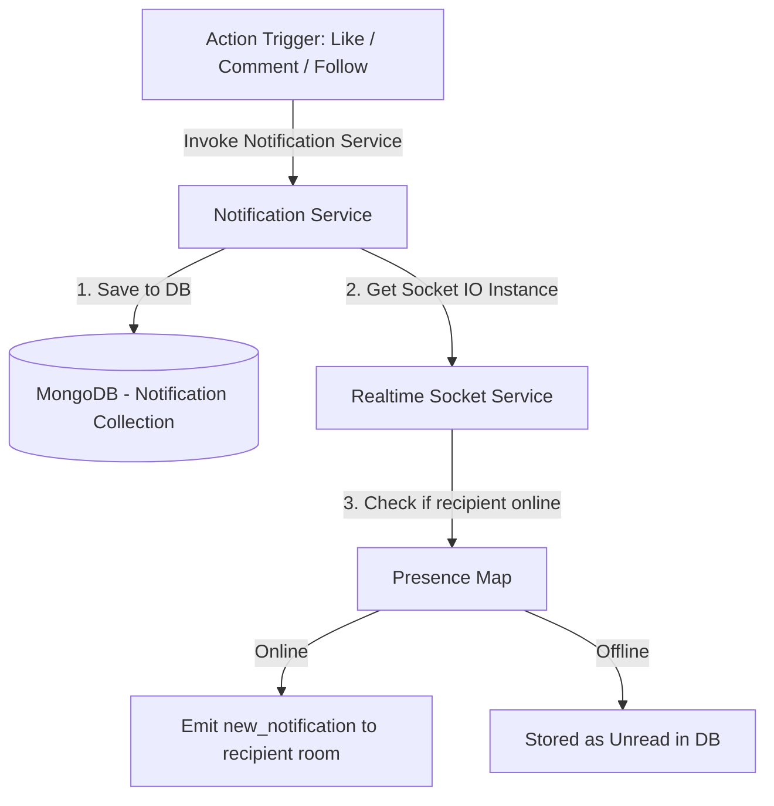

# Document Chức Năng 06: Notification System (Hệ Thống Thông Báo)

> **Tác giả**: Senior Fullstack Developer / Solutions Architect  
> **Dự án**: E-Community (BChat)  
> **Cập nhật gần nhất**: 2026-10-08  

---

## 1. Tổng Quan Chức Năng & Kiến Trúc (Overview & Architecture)

Hệ thống Thông báo (Notification System) thu thập và phân phối tất cả các sự kiện tương tác xảy ra trong ứng dụng (Thả tim bài viết, Bình luận mới, Người dùng mới follow, Tin nhắn đến, Cuộc gọi nhỡ) tới người nhận tương ứng. Thông báo vừa được lưu bền vững trong MongoDB, vừa được đẩy theo thời gian thực (Push Notification via Socket.io) nếu người nhận đang online.

---

## 2. Chi Tiết Kỹ Thuật Đã Triển Khai (Implemented Features & Tech Specs)

### 2.1 Backend Services & Data Schema

* **Model Schema (`backend/models/Notification.js`)**:
  * `recipient` (ObjectId `User`, Required, Index): Người nhận thông báo.
  * `sender` (ObjectId `User`, Required): Người thực hiện hành động.
  * `type` (String, Enum): `like_post`, `like_comment`, `comment_post`, `follow_user`, `message`, `call`.
  * `post` (ObjectId `Post`): Bài viết liên quan (nếu có).
  * `comment` (ObjectId `Comment`): Bình luận liên quan (nếu có).
  * `isRead` (Boolean, Default = false): Đã xem thông báo hay chưa.
  * `createdAt` (Timestamp).

* **API Endpoints (`backend/routes/notificationRoutes.js`)**:
  | Method | Endpoint | Auth Required | Mô Tả |
  | :--- | :--- | :---: | :--- |
  | `GET` | `/api/notifications` | Yes | Lấy danh sách thông báo của người dùng đăng nhập. |
  | `PATCH` | `/api/notifications/:id/read` | Yes | Đánh dấu 1 thông báo là đã đọc. |
  | `PATCH` | `/api/notifications/read-all` | Yes | Đánh dấu tất cả thông báo là đã đọc. |
  | `DELETE` | `/api/notifications/:id` | Yes | Xóa 1 thông báo khỏi danh sách. |

### 2.2 Frontend Integration

* **Notification Store (`frontend/src/stores/notificationStore.ts`)**:
  * Lưu trữ mảng thông báo, số lượng chưa đọc (unread count).
  * Tự động phát âm thanh báo hoặc hiển thị Badge màu đỏ ở Header khi có sự kiện `new_notification`.
* **Header Notification Dropdown / Popup**:
  * Hiển thị danh sách thông báo trực quan kèm avatar người gửi và thời gian tương đối.
  * Click vào thông báo tự động điều hướng đến bài viết/trang cá nhân tương ứng.

---

## 3. Hạn Chế, Lỗ Hổng & Thiếu Sót Hiện Tại (Limitations & Tech Debt)

> [!WARNING]
> Những điểm thiếu sót trong hệ thống thông báo hiện tại.

1. **Thiếu Web Push Notification (FCM / Service Worker)**:
   * **Hiện trạng**: Thông báo chỉ nhận được khi ứng dụng đang mở tab trình duyệt (qua Socket.io).
   * **Hạn chế**: Khi người dùng đóng trình duyệt hoặc dùng thiết bị di động ở chế độ chờ, họ **KHÔNG** nhận được bất kỳ thông báo nào.
   * **Giải pháp Senior**: Cần tích hợp **Firebase Cloud Messaging (FCM)** hoặc **Web Push API (Service Worker)** để đẩy thông báo hệ thống (Browser OS Push) khi trình duyệt đóng.

2. **Chưa Gom Group Thông Báo (Notification Aggregation / Batching)**:
   * **Hiện trạng**: Nếu bài viết có 100 người thả tim trong 5 phút, hệ thống sẽ gửi 100 thông báo riêng lẻ làm ngập tràn danh sách người dùng ("User A đã thích bài viết", "User B đã thích bài viết"...).
   * **Giải pháp**: Cần gom nhóm thông báo thành: *"User A và 99 người khác đã thích bài viết của bạn"*.

3. **Tạo Thông Báo Cho Chính Mình (Self-Notification Defect)**:
   * Cần đảm bảo khi người dùng tự like/comment bài viết của chính mình, hệ thống không tạo thông báo vô nghĩa gửi cho chính họ (Đã được lọc ở service, nhưng cần test bao phủ toàn bộ edge-cases).

---

## 4. Kế Hoạch Cải Tiến & Roadmap (Senior Dev Recommendations)

- [ ] **Task 1**: Tích hợp Firebase Cloud Messaging (FCM) & Web Push Service Worker cho thông báo ngoài trình duyệt.
- [ ] **Task 2**: Triển khai thuật toán Notification Aggregation (Gom nhóm thông báo trùng bài viết trong khoảng thời gian N phút).
- [ ] **Task 3**: Thêm thiết lập cài đặt bật/tắt nhận thông báo theo từng loại (Mute notifications settings) trong Setting Page.
- [ ] **Task 4**: Thêm nút "Xóa tất cả thông báo".
