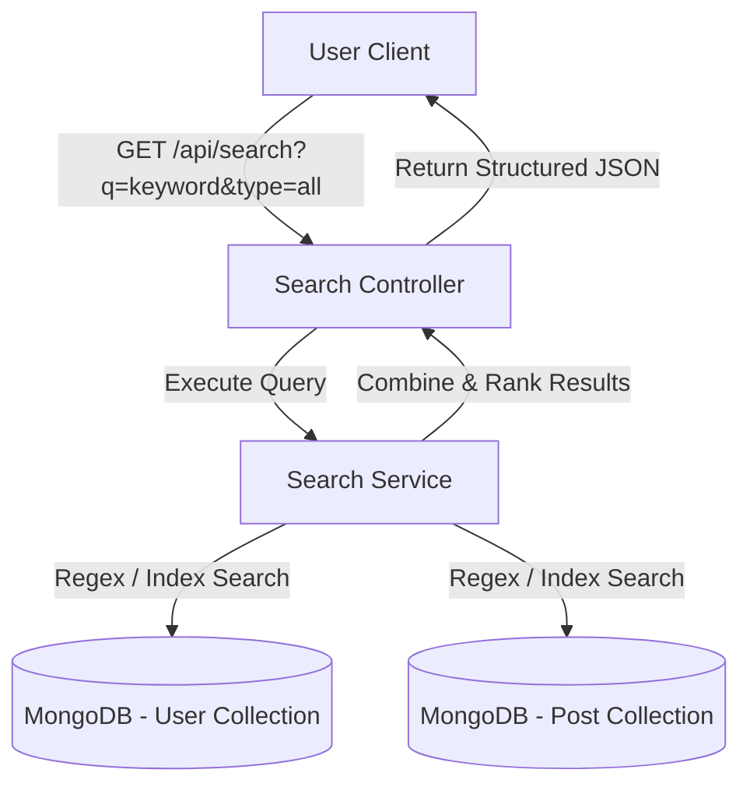

# Document Chức Năng 07: Search & Discovery System (Tìm Kiếm & Khám Phá)

> **Tác giả**: Senior Fullstack Developer / Solutions Architect  
> **Dự án**: E-Community (BChat)  
> **Cập nhật gần nhất**: 2026-10-08  

---

## 1. Tổng Quan Chức Năng & Kiến Trúc (Overview & Architecture)

Hệ thống Tìm kiếm & Khám phá (Search & Discovery) cung cấp tính năng tìm kiếm toàn cục (Global Search) cho phép người dùng tìm kiếm bạn bè theo tên/username, tìm kiếm bài viết theo từ khóa nội dung, và khám phá nội dung mới trên cộng đồng.

---

## 2. Chi Tiết Kỹ Thuật Đã Triển Khai (Implemented Features & Tech Specs)

### 2.1 Backend Services & API Endpoints

* **Search Service (`backend/services/searchService.js`)**:
  * Sử dụng MongoDB RegEx case-insensitive (`$regex: q, $options: 'i'`) để tìm kiếm người dùng và bài viết.
  * Hỗ trợ tìm kiếm theo loại (`type = users`, `type = posts`, `type = all`).

* **API Endpoints (`backend/routes/searchRoutes.js`)**:
  | Method | Endpoint | Auth Required | Mô Tả |
  | :--- | :--- | :---: | :--- |
  | `GET` | `/api/search` | Yes | Tìm kiếm người dùng và bài viết dựa trên từ khóa `q`. |

### 2.2 Frontend Integration

* **Search Store (`frontend/src/stores/searchStore.ts`)**:
  * Quản lý trạng thái từ khóa nhập, kết quả tìm kiếm người dùng và kết quả tìm kiếm bài viết.
  * Debounce tìm kiếm (300ms) tránh gửi request dồn dập khi gõ phím.
* **Search Page UI (`frontend/src/pages/SearchPage`)**:
  * Giao diện phân tab rõ ràng: "Tất cả", "Người dùng", "Bài viết".
  * Kết quả người dùng hiển thị kèm nút Follow/Unfollow trực tiếp.

---

## 3. Hạn Chế, Lỗ Hổng & Thiếu Sót Hiện Tại (Limitations & Tech Debt)

> [!WARNING]
> Những điểm hạn chế của cơ chế tìm kiếm MongoDB Regex hiện tại.

1. **Hiệu Năng Regex Tìm Kiếm Chậm (Full Table Scan Danger)**:
   * **Hiện trạng**: Đang dùng `$regex: q, $options: 'i'`.
   * **Rủi ro**: Regex với wildcard đầu chuỗi sẽ **KHÔNG THỂ** sử dụng B-Tree Index thông thường trong MongoDB. Khi hệ thống có hàng triệu document, query sẽ quét toàn bộ bảng (COLLSCAN), gây quá tải CPU MongoDB Server.
   * **Giải pháp Senior**:
     * Ngắn hạn: Tạo **MongoDB Text Index** trên trường `username`, `fullname`, `content` và dùng toán tử `$text: { $search: q }`.
     * Dài hạn: Đẩy dữ liệu sang **Elasticsearch / Meilisearch / Algolia** để hỗ trợ Full-text search chuyên nghiệp.

2. **Chưa Hỗ Trợ Tìm Kiếm Tiếng Việt Không Dấu (Accent-insensitive Search)**:
   * Khi tìm "Nguyen Van A" sẽ không khớp với "Nguyễn Văn A" nếu dùng Regex thông thường.
   * Cần cấu hình MongoDB Collation `locale: 'vi', strength: 1` hoặc thư viện chuẩn hóa không dấu (`unidecode`).

3. **Chưa Có Lịch Sử Tìm Kiếm (Search History)**:
   * Chưa lưu lại các từ khóa gần đây người dùng đã tìm kiếm để gợi ý nhanh.

4. **Chưa Có Hashtags (#hashtag) & Gợi Ý Xu Hướng (Trending Topics)**:
   * Chưa tự động bóc tách `#hashtag` từ nội dung bài viết để cho phép bấm vào xem danh sách bài viết thuộc cùng chủ đề.

---

## 4. Kế Hoạch Cải Tiến & Roadmap (Senior Dev Recommendations)

- [ ] **Task 1**: Cấu hình MongoDB Text Index và Text Search Engine cho User & Post.
- [ ] **Task 2**: Bổ sung MongoDB Collation hỗ trợ tìm kiếm Tiếng Việt không dấu (Accent-insensitive).
- [ ] **Task 3**: Tích hợp bóc tách `#hashtag` trong bài viết và làm trang Hashtag Feed.
- [ ] **Task 4**: Lưu Lịch sử tìm kiếm gần đây (Search History) trong LocalStorage / Redis.
- [ ] **Task 5**: Đánh giá tích hợp Meilisearch nếu dữ liệu bài viết vượt quá 100,000 bản ghi.
