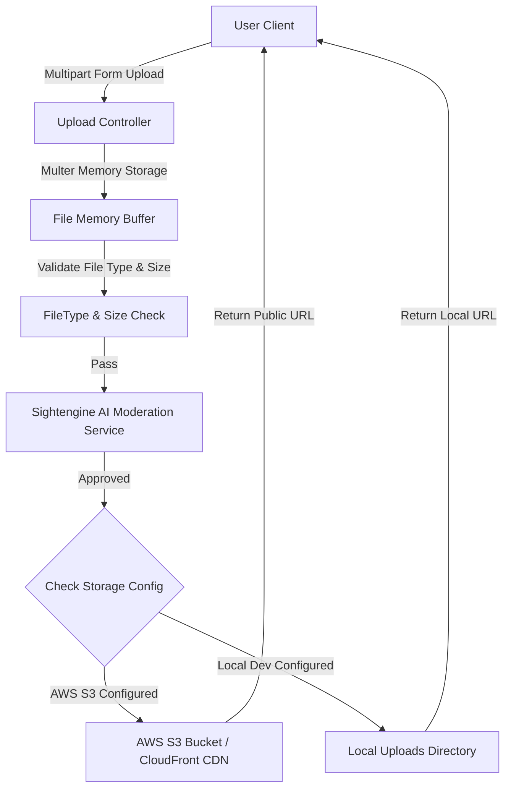

# Document Chức Năng 08: Upload & Media Storage (Tải Lên & Lưu Trữ Đa Phương Tiện)

> **Tác giả**: Senior Fullstack Developer / Solutions Architect  
> **Dự án**: E-Community (BChat)  
> **Cập nhật gần nhất**: 2026-10-08  

---

## 1. Tổng Quan Chức Năng & Kiến Trúc (Overview & Architecture)

Hệ thống Upload & Media Storage quản lý việc nhận file phương tiện (ảnh avatar, ảnh bài viết, ảnh bìa) từ phía client, kiểm tra định dạng và kích thước file, tích hợp luồng kiểm duyệt ảnh AI, sau đó lưu trữ file vào hạ tầng đám mây (AWS S3 Cloud Storage / Cloudinary) hoặc lưu trữ cục bộ (Local Disk) tùy theo môi trường triển khai.

---

## 2. Chi Tiết Kỹ Thuật Đã Triển Khai (Implemented Features & Tech Specs)

### 2.1 Backend Services & Middleware

* **Multer Storage Strategy (`backend/services/uploadService.js`)**:
  * Sử dụng `multer.memoryStorage()` để giữ file dưới dạng `Buffer` tạm thời trên RAM.
  * Giúp truyền trực tiếp Buffer vào dịch vụ kiểm duyệt ảnh Sightengine AI **trước khi** đẩy lên AWS S3 hoặc ghi vào ổ đĩa.
* **Storage Provider Flexibility**:
  * Nếu khai báo `AWS_ACCESS_KEY_ID`, `AWS_SECRET_ACCESS_KEY`, `AWS_S3_BUCKET_NAME` -> Tự động lưu lên **AWS S3** qua `@aws-sdk/client-s3`.
  * Nếu không khai báo -> Fallback về lưu vào thư mục đĩa cục bộ `uploads/`.

* **API Endpoints (`backend/routes/uploadRoutes.js`)**:
  | Method | Endpoint | Auth Required | Mô Tả |
  | :--- | :--- | :---: | :--- |
  | `POST` | `/api/uploads/single` | Yes | Upload 1 file ảnh (avatar / cover / post image). |
  | `POST` | `/api/uploads/multiple` | Yes | Upload nhiều file cùng lúc. |

---

## 3. Hạn Chế, Lỗ Hổng & Thiếu Sót Hiện Tại (Limitations & Tech Debt)

> [!WARNING]
> Rủi ro bộ nhớ và hiệu năng khi xử lý file upload dung lượng lớn.

1. **Rủi Ro Tràn Bộ Nhớ (RAM Exhaustion via MemoryStorage)**:
   * **Hiện trạng**: Đang dùng `multer.memoryStorage()`.
   * **Rủi ro**: Khi nhiều người dùng upload đồng thời các file ảnh/video dung lượng lớn (vd 10MB-50MB), RAM của Node.js process sẽ tăng vọt dẫn đến lỗi Out Of Memory (OOM Crash).
   * **Giải pháp Senior**:
     * Giới hạn kích thước file upload nghiêm ngặt ở Multer level (`limits: { fileSize: 5 * 1024 * 1024 }` - tối đa 5MB per image).
     * Dùng **S3 Presigned Upload URLs**: Client xin cấp Presigned URL từ backend, sau đó client **đẩy trực tiếp file từ trình duyệt lên S3**, giảm hoàn toàn gánh nặng I/O và RAM cho Backend Server.

2. **Chưa Nén & Tối Ưu Ảnh (Image Compression & WebP Conversion)**:
   * Ảnh người dùng upload được giữ nguyên kích thước gốc (có thể lên tới vài MB), gây tốn băng thông CDN và làm tải trang chậm.
   * Cần tích hợp thư viện **`sharp`** để tự động resize và convert ảnh sang định dạng chuẩn **WebP** trước khi lưu.

3. **Thiếu CDN Invalidation & Garbage Collection**:
   * Khi người dùng thay avatar mới, ảnh avatar cũ vẫn nằm lại trên S3 bucket mà không được dọn dẹp, gây lãng phí dung lượng lưu trữ (Storage leak).

---

## 4. Kế Hoạch Cải Tiến & Roadmap (Senior Dev Recommendations)

- [ ] **Task 1**: Tích hợp thư viện `sharp` nén ảnh tự động về WebP với độ phân giải tối ưu (Max width 1200px) trước khi lưu.
- [ ] **Task 2**: Chuyển sang mô hình **S3 Presigned Upload URL** để client upload trực tiếp lên Cloud, loại bỏ bottlenecks I/O ở backend.
- [ ] **Task 3**: Thêm worker dọn dẹp file mồ côi (Orphan file cleanup cronjob) tự động xóa các file không còn liên kết trong DB.
- [ ] **Task 4**: Cấu hình CDN AWS CloudFront với bộ nhớ đệm Cache-Control lâu dài.
