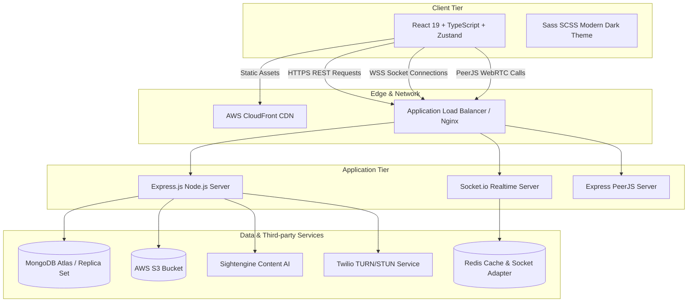

# Document Chức Năng 09: System Architecture, Security & DevOps (Kiến Trúc Hệ Thống & Vận Hành)

> **Tác giả**: Senior Fullstack Developer / Solutions Architect  
> **Dự án**: E-Community (BChat)  
> **Cập nhật gần nhất**: 2026-10-08  

---

## 1. Tổng Quan Kiến Trúc Tổng Thể (System Architecture Overview)

E-Community (BChat) được thiết kế theo mô hình **Client-Server Single-Page Application (SPA)** hoàn chỉnh kết hợp truyền dữ liệu song song qua **RESTful API** và **WebSocket Realtime Channel**.

---

## 2. Chi Tiết Kỹ Thuật Đã Triển Khai (Implemented Features & Tech Specs)

### 2.1 Backend Core Stack

* **Runtime & Framework**: Node.js v20+, Express.js 4.x.
* **Database**: MongoDB với ODM Mongoose. Kết nối qua `connectDatabase()` với tự động reconnect và pooling settings.
* **API Documentation**: Tích hợp **Swagger UI** tại `/api-docs` thông qua `swagger-autogen` & `swagger-ui-express`.
* **Global Error Middleware (`backend/middleware/errorHandler.js`)**: Quản lý lỗi tập trung, trả về format chuẩn JSON `{ error: string, statusCode: number }`.
* **Security & CORS**:
  * Cấu hình CORS whitelist nghiêm ngặt (`allowedOrigins`) bao gồm cả Dev localhost và Prod S3/CloudFront domain.
  * Ẩn thông tin nhạy cảm của user (`password`, `refreshToken`) thông qua `select('-password -refreshToken')`.

### 2.2 Frontend Core Stack

* **Build Tool & Framework**: Vite 5.x, React 19, TypeScript 5.x.
* **State Management**: **Zustand 5.x** phân chia theo từng domain riêng biệt:
  * `authStore`: Trạng thái người dùng và token.
  * `feedStore`: Trạng thái bảng tin bài viết.
  * `messageStore`: Trạng thái tin nhắn chat.
  * `notificationStore`: Trạng thái thông báo.
  * `presenceStore`: Trạng thái danh sách bạn bè online.
  * `webrtcStore`: Trạng thái cuộc gọi video/audio.
  * `searchStore`: Trạng thái từ khóa và kết quả tìm kiếm.
  * `uiStore`: Trạng thái modal và theme.
* **Styling**: Sass (SCSS) với hệ thống biến thiết kế tập trung (`_variables.scss`), hỗ trợ responsive mixins (`down()`, `up()`) chuẩn UI/UX Pro Max.

---

## 3. Hạn Chế, Lỗ Hổng & Thiếu Sót Hiện Tại (Limitations & Tech Debt)

> [!WARNING]
> Đánh giá rủi ro kiến trúc và an ninh hệ thống trước khi vận hành thực tế.

1. **Thiếu Middleware Bảo Vệ An Ninh Đỉnh Cao (Security Headers & Sanitization)**:
   * **Hiện trạng**: Chưa cài đặt **`helmet`** (bảo vệ HTTP Headers), chưa dùng **`express-mongo-sanitize`** (chống NoSQL Injection), chưa dùng **`xss-clean`** (chống XSS payload trong request body).
   * **Giải pháp Senior**: Bắt buộc cài bổ sung `helmet`, `express-mongo-sanitize`, `hpp` trong `app.js`.

2. **Chưa Có Hệ Thống Monitoring & Centralized Logging**:
   * Logs hiện tại mới chỉ `console.log()` đơn thuần ra terminal. Khi server crash hoặc xảy ra lỗi ở Production, log sẽ bị thất thoát.
   * Cần tích hợp logger chuẩn như **Winston / Pino** ghi file log và đẩy về **Sentry / Datadog / ELK Stack**.

3. **Chưa Có CI/CD Pipeline & Automated Testing**:
   * Thiếu script test tự động (Unit test / Integration test bằng Jest / Supertest / Playwright).
   * Chưa tạo GitHub Actions CI/CD để tự động kiểm tra code & deploy khi push branch `main`.

4. **Quản Lý Biến Môi Trường (Environment Variables Management)**:
   * Cần đảm bảo tất cả file `.env` được đưa vào `.gitignore` (Đã kiểm tra `.gitignore` có `.env`). Tuy nhiên cần có công cụ quản lý Secret Manager (AWS Secrets Manager / Vault) khi deploy sản phẩm lớn.

---

## 4. Kế Hoạch Cải Tiến & Roadmap (Senior Dev Recommendations)

- [ ] **Task 1**: Bổ sung gói an ninh `helmet`, `express-mongo-sanitize`, `hpp`, `express-rate-limit` vào `app.js`.
- [ ] **Task 2**: Tích hợp Winston Logger & Sentry Error Tracking cho Backend.
- [ ] **Task 3**: Viết Unit Test cho Auth & Post Services bằng Jest và Integration Test bằng Supertest.
- [ ] **Task 4**: Thiết lập GitHub Actions Workflow tự động kiểm tra `npm run build` và chạy test trước khi hợp nhất PR.
- [ ] **Task 5**: Cấu hình Docker Compose môi trường hoàn chỉnh (Backend + Frontend + MongoDB + Redis).
