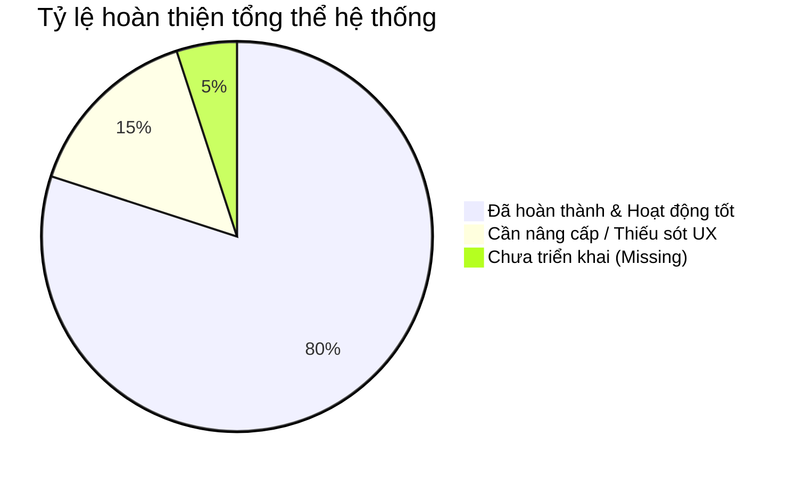

# BÁO CÁO TỔNG QUAN HỆ THỐNG & ĐÁNH GIÁ CHỨC NĂNG (SYSTEM SUMMARY & ARCHITECTURE AUDIT)

> **Dự án**: E-Community (BChat) - Mạng Xã Hội & Nền Tảng Trò Chuyện Trực Tuyến  
> **Tác giả**: Senior Fullstack Developer / Solutions Architect  
> **Ngày báo cáo**: 2026-10-08  
> **Thư mục tài liệu**: [d:/Project/E-Community/docs/](file:///d:/Project/E-Community/docs/)  

---

## 1. TỔNG QUAN DỰ ÁN & KIẾN TRÚC TỔNG THỂ (EXECUTIVE SUMMARY)

Dự án **E-Community (BChat)** được xây dựng theo mô hình **Modern Fullstack Single-Page Application (SPA)** kết hợp truyền thông thời gian thực song song:
* **Frontend**: React 19, TypeScript, Vite, Sass (SCSS) với hệ thống quản lý trạng thái tập trung **Zustand** (9 Stores độc lập), giao diện chuẩn UI/UX Pro Max hỗ trợ Dark Theme (`#1A1A1A` / `#282828` / `#eab308`).
* **Backend**: Node.js, Express.js RESTful API, MongoDB Mongoose ODM, Swagger OpenAPI documentation.
* **Realtime Communication**: **Socket.io** (Chat 1-1, Presence Online/Offline, Notification Push) & **Express PeerJS + Twilio TURN/STUN** (Cuộc gọi thoại & video WebRTC P2P).
* **AI & Security Services**: **Sightengine AI API** tự động kiểm duyệt hình ảnh tải lên trước khi đưa vào hệ thống.

---

## 2. DANH MỤC TÀI LIỆU CHI TIẾT THEO TỪNG CHỨC NĂNG (DOCUMENT INDEX)

Tất cả các mô-đun chức năng và dịch vụ cốt lõi đã được kiểm tra chi tiết và lưu tại thư mục [docs/](file:///d:/Project/E-Community/docs/):

| STT | Tài Liệu Mô-đun | Tóm Tắt Nội Dung | Trạng Thái |
| :---: | :--- | :--- | :---: |
| 01 | [01-auth-user-management.md](file:///d:/Project/E-Community/docs/01-auth-user-management.md) | Đăng ký, Đăng nhập, Dual JWT Tokens, Trang cá nhân, Hệ thống Follow/Unfollow. | 🟢 Hoàn thiện 85% |
| 02 | [02-post-feed-system.md](file:///d:/Project/E-Community/docs/02-post-feed-system.md) | Đăng bài viết, Thả tim, Phân trang Feed, Tích hợp Sightengine AI Moderation. | 🟢 Hoàn thiện 80% |
| 03 | [03-comment-system.md](file:///d:/Project/E-Community/docs/03-comment-system.md) | Bình luận bài viết, Thả tim bình luận, Xóa bình luận theo phân quyền. | 🟡 Hoàn thiện 70% |
| 04 | [04-realtime-messaging.md](file:///d:/Project/E-Community/docs/04-realtime-messaging.md) | Nhắn tin 1-1, Trạng thái bạn bè Online/Offline thời gian thực, Lịch sử hội thoại. | 🟢 Hoàn thiện 85% |
| 05 | [05-webrtc-audio-video-call.md](file:///d:/Project/E-Community/docs/05-webrtc-audio-video-call.md) | Gọi thoại & Video call WebRTC P2P, Signaling qua Socket.io, Twilio TURN/STUN. | 🟢 Hoàn thiện 80% |
| 06 | [06-notification-system.md](file:///d:/Project/E-Community/docs/06-notification-system.md) | Thông báo tương tác (Like, Comment, Follow, Message) lưu DB & Push Socket. | 🟢 Hoàn thiện 75% |
| 07 | [07-search-discovery.md](file:///d:/Project/E-Community/docs/07-search-discovery.md) | Tìm kiếm toàn cục Người dùng và Bài viết, Lọc kết quả, Debounce tìm kiếm. | 🟡 Hoàn thiện 70% |
| 08 | [08-upload-media-storage.md](file:///d:/Project/E-Community/docs/08-upload-media-storage.md) | Multer Memory Storage, Upload AWS S3 Cloud Storage / Local Storage fallback. | 🟢 Hoàn thiện 85% |
| 09 | [09-system-architecture-devops.md](file:///d:/Project/E-Community/docs/09-system-architecture-devops.md) | Swager Docs, Global Error Handler, CORS Policy, Zustand Stores, SCSS Design. | 🟢 Hoàn thiện 80% |

---

## 3. BẢNG ĐÁNH GIÁ CHỨC NĂNG ĐÃ LÀM VÀ CÒN THIẾU (FEATURE CHECKLIST & AUDIT)

### 3.1 Các Chức Năng Đã Hoàn Thành (Implemented & Operational)
- [x] **Xác thực an toàn**: Đăng ký, Đăng nhập mã hóa bcrypt, Access Token & Refresh Token JWT.
- [x] **Giao diện Auth UI/UX Pro Max**: Hero 2-column layout, hiển thị/ẩn mật khẩu, input icons, thông báo lỗi chuẩn.
- [x] **Quản lý Hồ sơ & Follow**: Cập nhật bio/avatar/cover, xem số lượng follower/following, follow/unfollow thời gian thực.
- [x] **Đăng bài viết & Thả tim**: Tạo bài viết đính kèm ảnh, thả tim/bỏ thả tim bài viết.
- [x] **Kiểm duyệt ảnh AI (Content Moderation)**: Tích hợp Sightengine API tự động chặn ảnh khiêu dâm/bạo lực.
- [x] **Bình luận bài viết**: Thêm, xem, xóa và thả tim bình luận.
- [x] **Trò chuyện trực tuyến (Messaging)**: Nhắn tin 1-1 thời gian thực, lưu trữ tin nhắn, danh sách hội thoại.
- [x] **Theo dõi trạng thái bạn bè (Presence Tracking)**: Hiển thị chấm xanh bạn bè Online/Offline thời gian thực.
- [x] **Gọi thoại & Video Call WebRTC**: Tích hợp PeerJS + Socket signaling + Twilio ICE Server cấp phát TURN/STUN.
- [x] **Thông báo thời gian thực (Notifications)**: Đẩy thông báo tức thì khi có người thả tim, bình luận, follow.
- [x] **Tìm kiếm toàn cục**: Tìm người dùng & bài viết có debounce.

### 3.2 Các Hạn Chế & Tính Năng Còn Thiếu Cần Cải Thiện (Gaps & Tech Debt Audit)

> [!IMPORTANT]
> Dưới đây là danh sách chi tiết các thiếu sót kiến trúc, an ninh và trải nghiệm người dùng được phân loại theo mức độ ưu tiên từ quan điểm của Senior Fullstack Engineer:

#### A. An Ninh & Bảo Mật (Security & Auth)
1. **Refresh Token lưu tại LocalStorage**: Cần chuyển sang **`httpOnly Cookie`** để chống tấn công XSS.
2. **Thiếu Rate Limiting**: Chưa có `express-rate-limit` chống tấn công Brute-force mật khẩu & DDoS API.
3. **Thiếu OTP / Email Verification**: Luồng Đăng ký và Quên mật khẩu hiện chưa gửi email thực qua SMTP (Nodemailer / AWS SES).
4. **Thiếu Web Security Headers**: Chưa cấu hình `helmet`, `express-mongo-sanitize` (chống NoSQL Injection) trong Express app.

#### B. Trải Nghiệm Bài Viết & Bình Luận (Post & Comment UX)
1. **Thuật toán Feed đơn giản**: Chưa lọc bài viết theo danh sách `following`, chưa hỗ trợ phân trang Cursor-based.
2. **Một ảnh duy nhất**: Bài viết và Chat mới chỉ hỗ trợ 1 ảnh, chưa hỗ trợ album ảnh (Carousel/Grid) hoặc Video.
3. **Bình luận phẳng (1-level)**: Chưa hỗ trợ bình luận phân cấp (Nested Replies / Reply to comment).
4. **Thiếu Mention & Hashtag**: Chưa hỗ trợ `@username` và `#hashtag` trong nội dung bài viết/bình luận.

#### C. Trò Chuyện & WebRTC (Realtime & Call)
1. **Khả năng mở rộng đa server (Socket Scaling)**: Socket server đang lưu Presence trên RAM của 1 instance duy nhất, cần thêm **`@socket.io/redis-adapter`** để chạy cluster nhiều node backend.
2. **Thiếu đính kèm file trong Chat**: Chưa gửi được ảnh/file trong khung chat.
3. **Thiếu Typing Indicator**: Chưa có hiệu ứng "đang gõ tin nhắn...".
4. **Thiếu Timeout cuộc gọi**: Cuộc gọi không tự động kết thúc nếu người nhận không nghe máy sau 40s (chưa phát sinh Cuộc gọi nhỡ).

#### D. Quản Lý File & Vận Hành (Media & DevOps)
1. **Rủi ro RAM khi Upload**: Đang dùng `multer.memoryStorage()`. Cần nén ảnh tự động bằng **`sharp`** về định dạng WebP hoặc dùng **S3 Presigned Upload URLs**.
2. **Thiếu Push Notification ngoài trình duyệt**: Chưa có Firebase Cloud Messaging (FCM) / Service Worker cho thông báo khi đóng tab.
3. **Thiếu CI/CD & Automated Testing**: Chưa có script test tự động (Jest/Supertest) và GitHub Actions.

---

## 4. KẾ HOẠCH HÀNH ĐỘNG & ROADMAP NÂNG CẤP DÀNH CHO TEAM (DEVELOPMENT ROADMAP)

### 🎯 Giai Đoạn 1: Củng Cố An Ninh & Tối Ưu Hạ Tầng Core (Ưu tiên Cao - Tuần 1-2)
- [ ] Chuyển Refresh Token sang `httpOnly, Secure, SameSite` Cookie.
- [ ] Thêm `express-rate-limit`, `helmet`, `express-mongo-sanitize` cho backend.
- [ ] Tích hợp `@socket.io/redis-adapter` và cấu hình Redis Server.
- [ ] Tích hợp thư viện `sharp` nén ảnh upload tự động về WebP (Max width 1200px, quality 80%).

### 🎯 Giai Đoạn 2: Nâng Cấp Tính Năng Bài Viết & Bình Luận (Tuần 3-4)
- [ ] Triển khai Personal Newsfeed API (chỉ lấy bài của mình + người theo dõi) dùng Cursor Pagination.
- [ ] Nâng cấp Schema `Post` hỗ trợ mảng nhiều ảnh `images: [String]`.
- [ ] Nâng cấp Schema `Comment` với trường `parentId` để làm tính năng Trả lời bình luận (Nested Replies).
- [ ] Tích hợp Emoji Picker cho ô đăng bài và ô bình luận.

### 🎯 Giai Đoạn 3: Nâng Cấp Chat & WebRTC Call (Tuần 5-6)
- [ ] Cho phép gửi hình ảnh và file tài liệu trong khung nhắn tin.
- [ ] Thêm Socket event `typing` hiển thị trạng thái đang gõ.
- [ ] Thêm Timer timeout 40s cho cuộc gọi WebRTC và tự động tạo thông báo "Cuộc gọi nhỡ".
- [ ] Thêm tính năng Chia sẻ màn hình (Screen Sharing) trong cuộc gọi video.

### 🎯 Giai Đoạn 4: Email, Push Notification & DevOps (Tuần 7-8)
- [ ] Tích hợp Nodemailer + Redis gửi mã OTP xác thực email và khôi phục mật khẩu.
- [ ] Tích hợp Web Push Notification (FCM / Service Worker).
- [ ] Bổ sung Unit Test (Jest) và thiết lập pipeline GitHub Actions CI/CD.

---

> [!NOTE]
> Báo cáo tổng quan này cung cấp cái nhìn toàn diện về hiện trạng dự án **E-Community (BChat)**. Chi tiết kỹ thuật sâu hơn của từng mô-đun có thể xem thêm tại các liên kết tài liệu thuộc thư mục [docs/](file:///d:/Project/E-Community/docs/).
