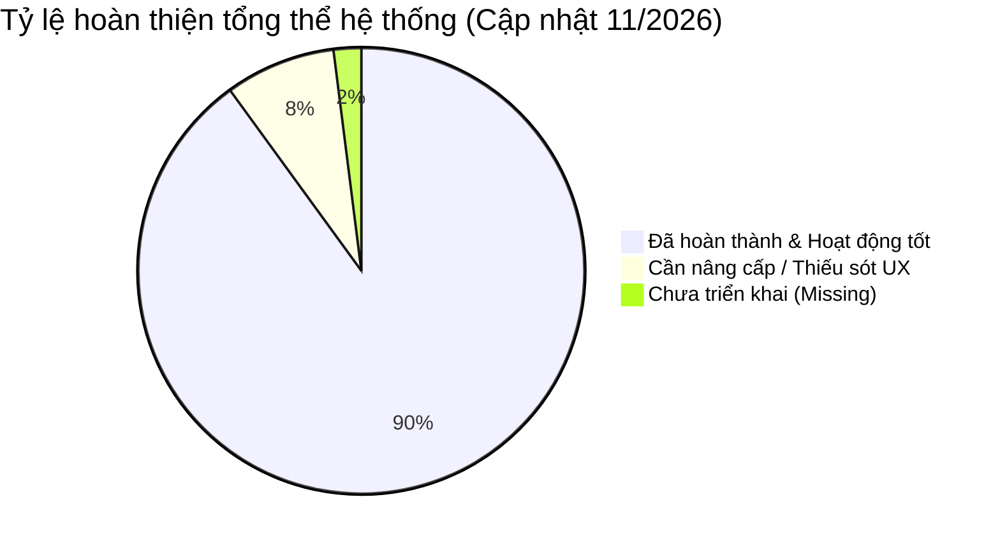

# BÁO CÁO TỔNG QUAN HỆ THỐNG & ĐÁNH GIÁ CHỨC NĂNG (SYSTEM SUMMARY & ARCHITECTURE AUDIT)

> **Dự án**: E-Community (BChat) - Mạng Xã Hội & Nền Tảng Trò Chuyện Trực Tuyến  
> **Tác giả**: Senior Fullstack Developer / Solutions Architect  
> **Cập nhật gần nhất**: 2026-11-16  
> **Thư mục tài liệu**: [d:/Project/E-Community/docs/](file:///d:/Project/E-Community/docs/)  

---

## 1. TỔNG QUAN DỰ ÁN & KIẾN TRÚC TỔNG THỂ (EXECUTIVE SUMMARY)

Dự án **E-Community (BChat)** được xây dựng theo mô hình **Modern Fullstack Single-Page Application (SPA)** kết hợp truyền thông thời gian thực song song:
* **Frontend**: React 19, TypeScript, Vite, Sass (SCSS) với hệ thống quản lý trạng thái tập trung **Zustand** (9 Stores độc lập), giao diện chuẩn UI/UX Pro Max hỗ trợ Dark Theme (`#1A1A1A` / `#282828` / `#eab308`).
* **Backend**: Node.js, Express.js RESTful API, MongoDB Mongoose ODM, Swagger OpenAPI documentation.
* **Email & Cloud Security**: Tích hợp **Resend HTTPS API (Port 443)** gửi mã xác minh OTP siêu tốc cho môi trường Render Cloud, kết hợp **Rate Limiting** (`express-rate-limit`) chống brute-force và spam.
* **Realtime Communication**: **Socket.io** (Chat 1-1, Presence Online/Offline, Notification Push) & **Express PeerJS + Twilio TURN/STUN** (Cuộc gọi thoại & video WebRTC P2P).
* **AI & Security Services**: **Sightengine AI API** tự động kiểm duyệt hình ảnh tải lên trước khi đưa vào hệ thống.
* **Architecture Knowledge Graph**: Đã tích hợp **Graphify** phân tích cấu trúc mã nguồn toàn vẹn (686 nodes, 1,260 edges, 59 communities).

---

## 2. DANH MỤC TÀI LIỆU CHI TIẾT THEO TỪNG CHỨC NĂNG (DOCUMENT INDEX)

Tất cả các mô-đun chức năng và dịch vụ cốt lõi đã được kiểm tra chi tiết và lưu tại thư mục [docs/](file:///d:/Project/E-Community/docs/):

| STT | Tài Liệu Mô-đun | Tóm Tắt Nội Dung | Trạng Thái |
| :---: | :--- | :--- | :---: |
| 01 | [01-auth-user-management.md](file:///d:/Project/E-Community/docs/01-auth-user-management.md) | Đăng ký, Đăng nhập, Dual JWT, Quên mật khẩu OTP Email qua Resend, Rate Limiting, Trang cá nhân, Follow/Unfollow. | 🟢 Hoàn thiện 100% |
| 02 | [02-post-feed-system.md](file:///d:/Project/E-Community/docs/02-post-feed-system.md) | Đăng bài viết, Thả tim, Phân trang Feed, Tích hợp Sightengine AI Moderation. | 🟢 Hoàn thiện 80% |
| 03 | [03-comment-system.md](file:///d:/Project/E-Community/docs/03-comment-system.md) | Bình luận bài viết, Thả tim bình luận, Xóa bình luận, **Nested Replies (Reply to Comment)**. | 🟢 Hoàn thiện 85% |
| 04 | [04-realtime-messaging.md](file:///d:/Project/E-Community/docs/04-realtime-messaging.md) | Nhắn tin 1-1, Trạng thái bạn bè Online/Offline thời gian thực, Lịch sử hội thoại. | 🟢 Hoàn thiện 85% |
| 05 | [05-webrtc-audio-video-call.md](file:///d:/Project/E-Community/docs/05-webrtc-audio-video-call.md) | Gọi thoại & Video call WebRTC P2P, Signaling qua Socket.io, Twilio TURN/STUN. | 🟢 Hoàn thiện 80% |
| 06 | [06-notification-system.md](file:///d:/Project/E-Community/docs/06-notification-system.md) | Thông báo tương tác (Like, Comment, Follow, Message) lưu DB & Push Socket. | 🟢 Hoàn thiện 75% |
| 07 | [07-search-discovery.md](file:///d:/Project/E-Community/docs/07-search-discovery.md) | Tìm kiếm toàn cục Người dùng và Bài viết, Lọc kết quả, Debounce tìm kiếm. | 🟡 Hoàn thiện 70% |
| 08 | [08-upload-media-storage.md](file:///d:/Project/E-Community/docs/08-upload-media-storage.md) | Multer Memory Storage, Upload Cloudinary Cloud Storage. | 🟢 Hoàn thiện 85% |
| 09 | [09-system-architecture-devops.md](file:///d:/Project/E-Community/docs/09-system-architecture-devops.md) | Swagger Docs, Global Error Handler, CORS Policy, Zustand Stores, SCSS Design, Graphify Knowledge Graph. | 🟢 Hoàn thiện 85% |

---

## 3. BẢNG ĐÁNH GIÁ CHỨC NĂNG ĐÃ LÀM VÀ CÒN THIẾU (FEATURE CHECKLIST & AUDIT)

### 3.1 Các Chức Năng Đã Hoàn Thành (Implemented & Operational)
- [x] **Xác thực an toàn & Token Rotation (Task 1.1)**: Dual JWT Token, Refresh Token Rotation, Token Reuse Detection, lưu hoàn toàn trong `httpOnly, Secure, SameSite=None` Cookie chống XSS.
- [x] **Tối ưu Follow/Unfollow Atomic (Task 1.2)**: Toán tử nguyên tử MongoDB `$addToSet` và `$pull` chống Race Condition & Chặn tự follow.
- [x] **Đăng nhập Google OAuth 2.0 In Production (Task 1.3)**: Google Identity Services (GIS), xử lý TH1 đăng nhập nhanh và TH2 hoàn tất hồ sơ độc nhất.
- [x] **Xác thực Email OTP khi Đăng ký mới (Task 1.4)**: Băm bcrypt, TTL 10 phút, gửi qua Resend HTTPS API (Port 443), tự động kích hoạt và đăng nhập.
- [x] **Quên mật khẩu & Gửi OTP qua Email**: Luồng 4 bước UI/UX Pro Max, mã OTP 6 số hash bcrypt, MongoDB TTL 10 phút, cấp resetToken trung gian, gửi mail siêu tốc qua **Resend HTTPS API (Port 443)** không bị Render firewall chặn.
- [x] **Chống Brute-force & Spam (Rate Limiter)**: Áp dụng `authLimiter` (10 req/15m) cho login/register và `otpLimiter` (5 req/15m) cho forgot-password/verify-email, kết hợp `trust proxy`.
- [x] **Giao diện Auth UI/UX Pro Max**: Hero 2-column layout, hiển thị/ẩn mật khẩu, input icons, đếm ngược 60s, email masking.
- [x] **Quản lý Hồ sơ & Follow**: Cập nhật bio/avatar/cover, xem số lượng follower/following, follow/unfollow thời gian thực.
- [x] **Đăng bài viết & Thả tim**: Tạo bài viết đính kèm ảnh, thả tim/bỏ thả tim bài viết.
- [x] **Kiểm duyệt ảnh AI (Content Moderation)**: Tích hợp Sightengine API tự động chặn ảnh khiêu dâm/bạo lực.
- [x] **Bình luận bài viết**: Thêm, xem, xóa và thả tim bình luận.
- [x] **Trò chuyện trực tuyến (Messaging)**: Nhắn tin 1-1 thời gian thực, lưu trữ tin nhắn, danh sách hội thoại.
- [x] **Theo dõi trạng thái bạn bè (Presence Tracking)**: Hiển thị chấm xanh bạn bè Online/Offline thời gian thực.
- [x] **Gọi thoại & Video Call WebRTC**: Tích hợp PeerJS + Socket signaling + Twilio ICE Server cấp phát TURN/STUN.
- [x] **Thông báo thời gian thực (Notifications)**: Đẩy thông báo tức thì khi có người thả tim, bình luận, follow.
- [x] **Tìm kiếm toàn cục**: Tìm người dùng & bài viết có debounce.
- [x] **Kiểm toán mã nguồn tự động**: Tích hợp Graphify Knowledge Graph hỗ trợ phát hiện điểm nghẽn kiến trúc và AI context traversal.
- [x] **Nested Comments (Reply to Comment)**: Hỗ trợ trả lời bình luận phân cấp đa cấp (max 3 cấp), cascading delete, notification cho người được reply.

### 3.2 Các Hạn Chế & Tính Năng Còn Thiếu Cần Cải Thiện (Gaps & Tech Debt Audit)

#### A. Trải Nghiệm Bài Viết & Bình Luận (Post & Comment UX - Nhóm 2)
1. **Một ảnh duy nhất**: Bài viết mới chỉ hỗ trợ 1 ảnh, chưa hỗ trợ album ảnh (Carousel/Grid) hoặc video (Task 2.1).
2. ~~**Bình luận phẳng (1-level)**: Chưa hỗ trợ bình luận phân cấp (Nested Replies / Trả lời bình luận con với `parentId`) (Task 2.2).~~ ✅ **ĐÃ HOÀN THIỆN 2026-11-16**
3. **Emoji & Tương tác**: Chưa có Emoji Picker cho ô đăng bài và bình luận (Task 2.3).
4. **Thuật toán Feed đơn giản**: Chưa có trang New Feed lọc riêng bài viết của những người mình đang `following`, chưa hỗ trợ phân trang Cursor-based (Task 2.4).

#### C. Trò Chuyện & WebRTC (Realtime & Call)
1. **Đính kèm file trong Chat**: Chưa hỗ trợ gửi hình ảnh, video, hoặc tài liệu trong khung chat 1-1.
2. **Typing Indicator**: Chưa có hiệu ứng hiển thị "đang soạn tin nhắn...".
3. **Timeout Cuộc gọi WebRTC**: Cuộc gọi không tự động kết thúc nếu đối phương không bắt máy sau 40 giây (chưa phát sinh thông báo "Cuộc gọi nhỡ").
4. **Chia sẻ màn hình (Screen Sharing)**: Chưa có nút share màn hình khi đang gọi video.
5. **Khả năng mở rộng Socket**: Cần tích hợp `@socket.io/redis-adapter` khi scale nhiều instance backend.

#### D. Quản Lý File & Vận Hành (Media & DevOps)
1. **Tối ưu dung lượng ảnh**: Nên nén ảnh tự động bằng thư viện **`sharp`** về định dạng WebP (chất lượng 80%) trước khi tải lên Cloudinary để tiết kiệm băng thông và tăng tốc độ tải trang.
2. **Push Notification ngoài tab**: Chưa có Service Worker / Web Push Notification khi người dùng tắt trình duyệt.
3. **Automated Testing & CI/CD**: Chưa có bộ kiểm thử tự động (Jest/Supertest) và GitHub Actions pipeline.

---

## 4. KẾ HOẠCH HÀNH ĐỘNG & ROADMAP NÂNG CẤP TIẾP THEO

### 🎯 Giai Đoạn 1: Hoàn Thiện An Ninh Nâng Cao & Đăng Nhập Nhanh (Ưu tiên Cao nhất)
- [x] Chuyển Refresh Token sang `httpOnly, Secure, SameSite` Cookie & Triển khai Refresh Token Rotation chống Replay Attack (Task 1.1).
- [x] Tối ưu câu lệnh Follow/Unfollow dùng `$addToSet` và `$pull` chống Race Condition & chặn tự follow (Task 1.2).
- [x] Tích hợp Google OAuth 2.0 (Google Login 1-click & Hoàn tất Profile Username) (Task 1.3).
- [x] Xác thực Email khi Đăng ký mới (Verify Email OTP) & Tự động kích hoạt đăng nhập (Task 1.4).

### 🎯 Giai Đoạn 2: Nâng Cấp Trải Nghiệm Bài Viết & Bình Luận (Tuần tiếp theo)
- [ ] Nâng cấp Schema `Post` và UI hỗ trợ Album nhiều ảnh (Carousel / Grid).
- [x] Triển khai Nested Comments (Bình luận phân cấp cha - con với `parentId`) - **HOÀN THIỆN 2026-11-16**.
- [ ] Tích hợp Emoji Picker cho ô soạn thảo bài viết và bình luận.
- [ ] Xây dựng tab Feed "Đang theo dõi" (Following Feed) dùng Cursor Pagination.

### 🎯 Giai Đoạn 3: Nâng Cấp Chat Realtime & WebRTC Call
- [ ] Cho phép gửi ảnh và file đính kèm trong khung Chat.
- [ ] Thêm Socket event `typing` / `stop-typing` hiển thị trạng thái đang soạn thảo.
- [ ] Bổ sung bộ đếm timeout 40s cho cuộc gọi và phát sinh thông báo "Cuộc gọi nhỡ".
- [ ] Tính năng Chia sẻ màn hình (Screen Sharing) trong cuộc gọi WebRTC.

### 🎯 Giai Đoạn 4: Tối Ưu Hiệu Năng & DevOps
- [ ] Tích hợp `sharp` nén ảnh tự động trước khi upload Cloudinary.
- [ ] Cấu hình Web Push Notification (FCM / Web Push API).
- [ ] Viết Unit Test / Integration Test với Jest & Supertest.
